> **This repository is for Spira.ai and its team only.** It is the intellectual property of Jeff Mouie Ramirez, strictly confidential, and is not to be shared outside the team or used for personal gain. Upon leaving the company, the copy on your local device must be removed, as it is subject to your NDA. Any misuse of this material is a breach of that NDA and will be treated as one.

# Content Maxima

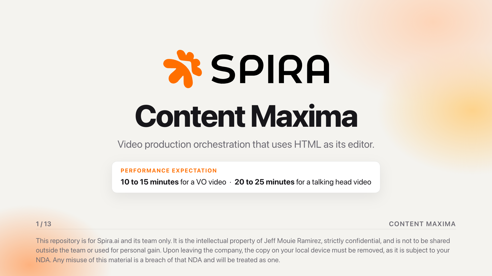

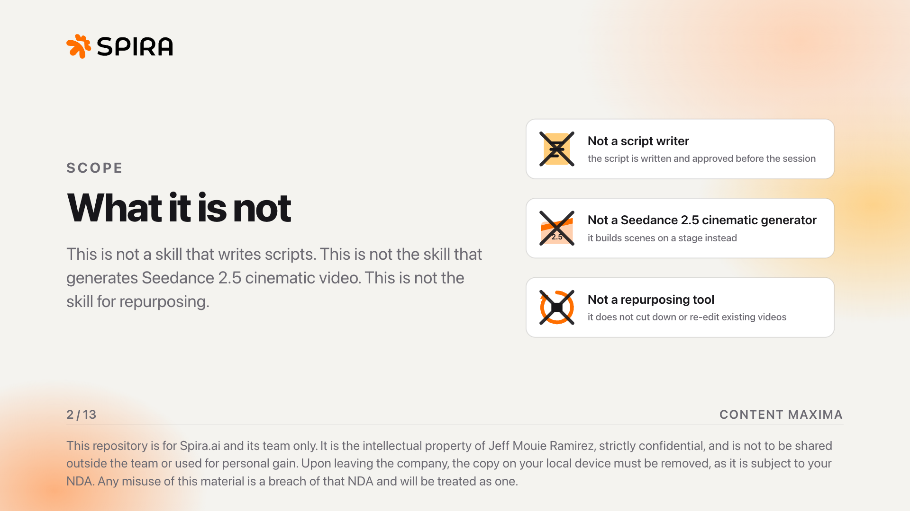

## Getting started

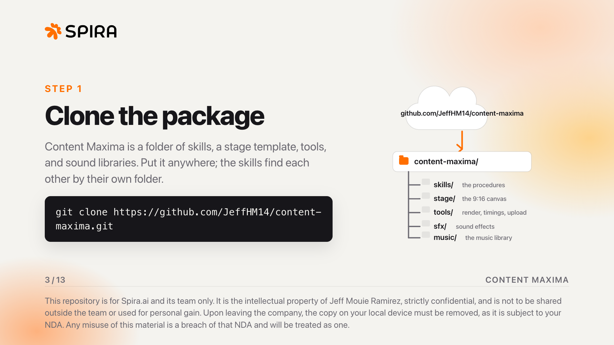

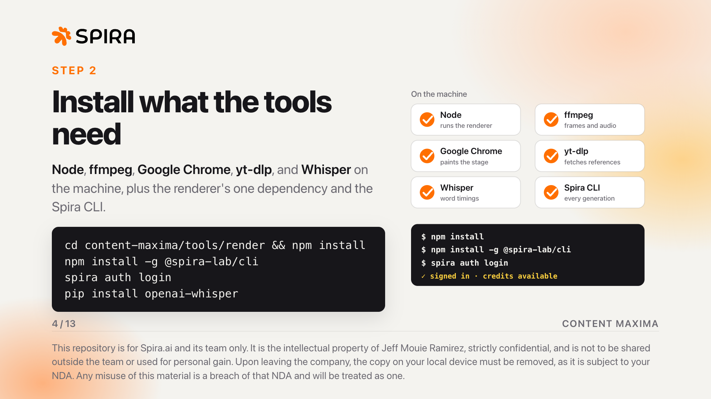

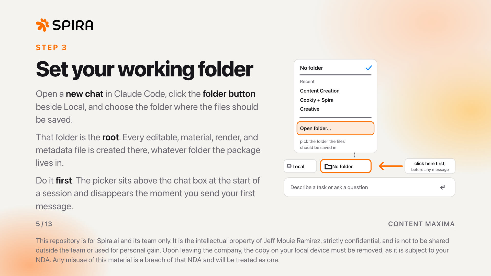

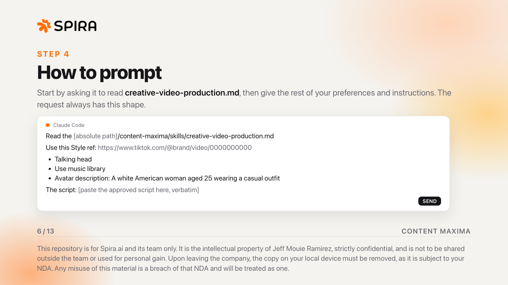

## How to use

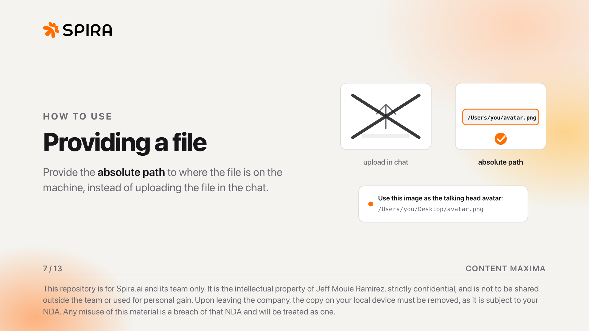

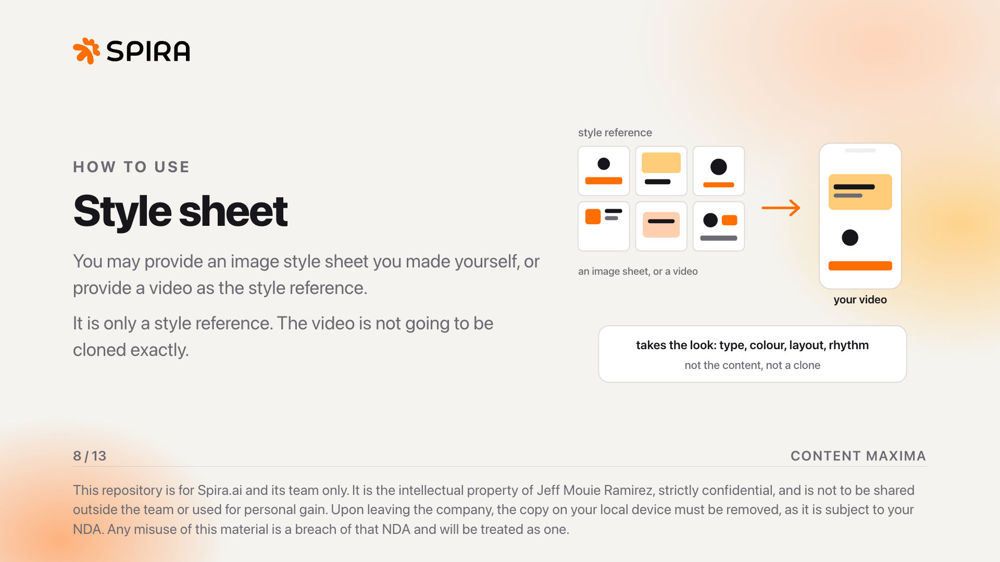

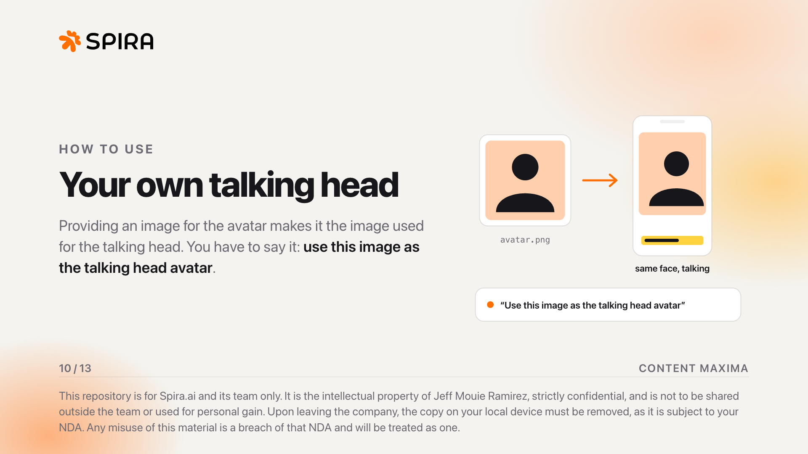

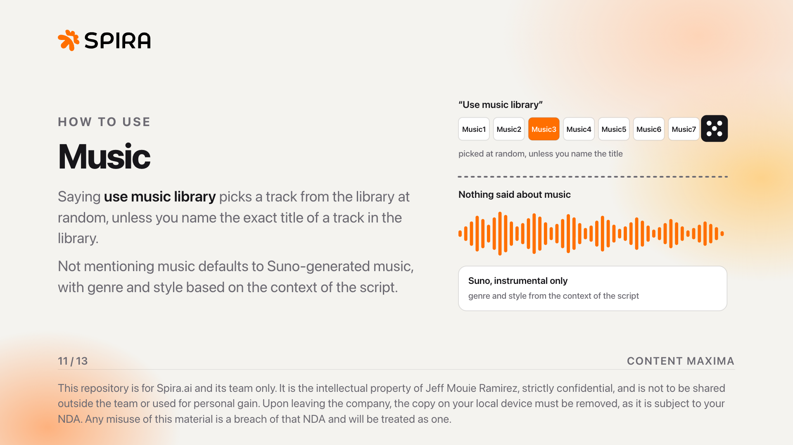

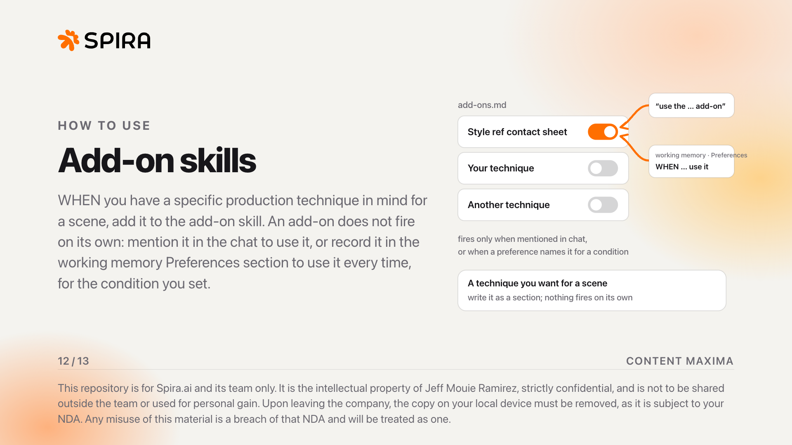

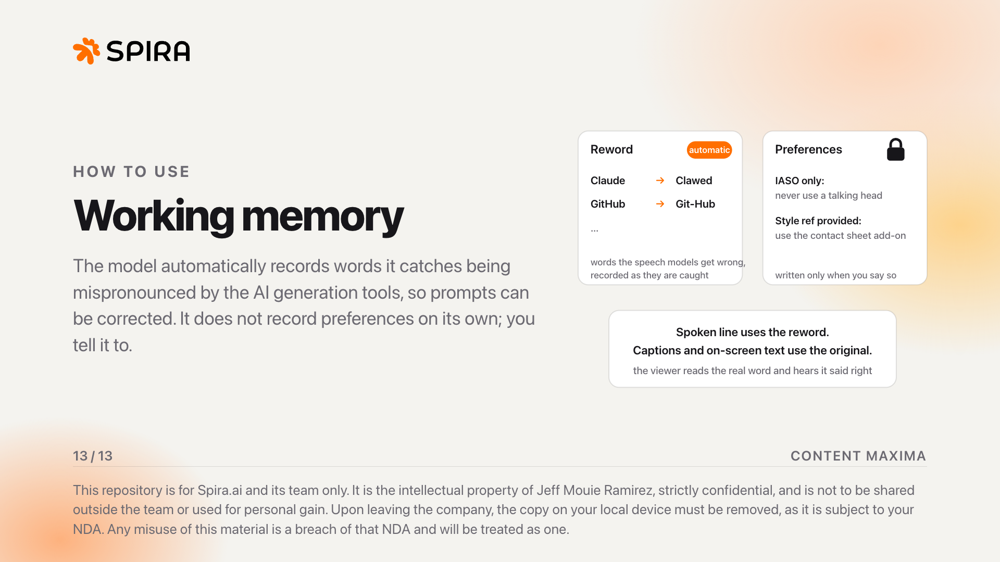

## What is in the package

| Folder | Holds |
|--------|-------|
| `skills/` | The procedures a session reads: creative video production, toolkit, prompting, stage canvas HTML, file management, known methods, add-ons, working memory |
| `stage/` | The 9:16 stage template every editable is copied from |
| `tools/` | The renderer and stage audit, the generation, captions and cover scripts, the Whisper timings and music bed scripts |
| `sfx/` | Sound effects and their metadata |
| `music/` | The music library, numbered tracks |
| `docs/` | These cards and the script that renders them |

The cards are generated from `docs/steps.html`. After editing it, run `node docs/render-steps.js` from the package folder to refresh the images.
