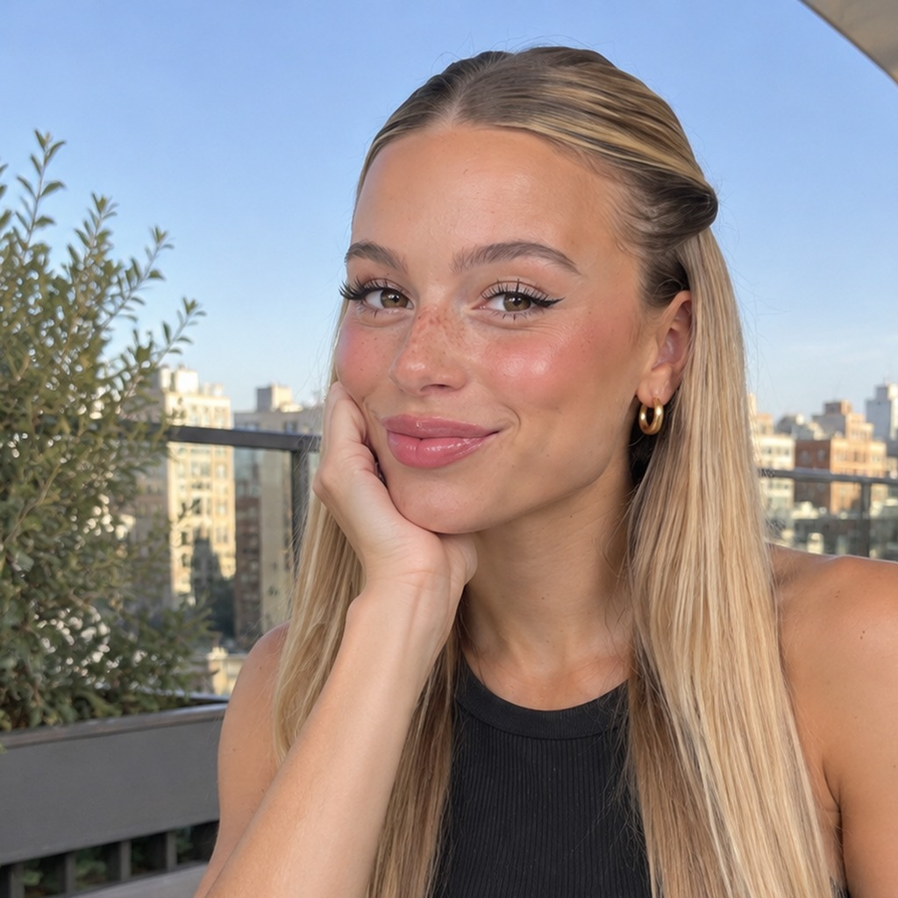
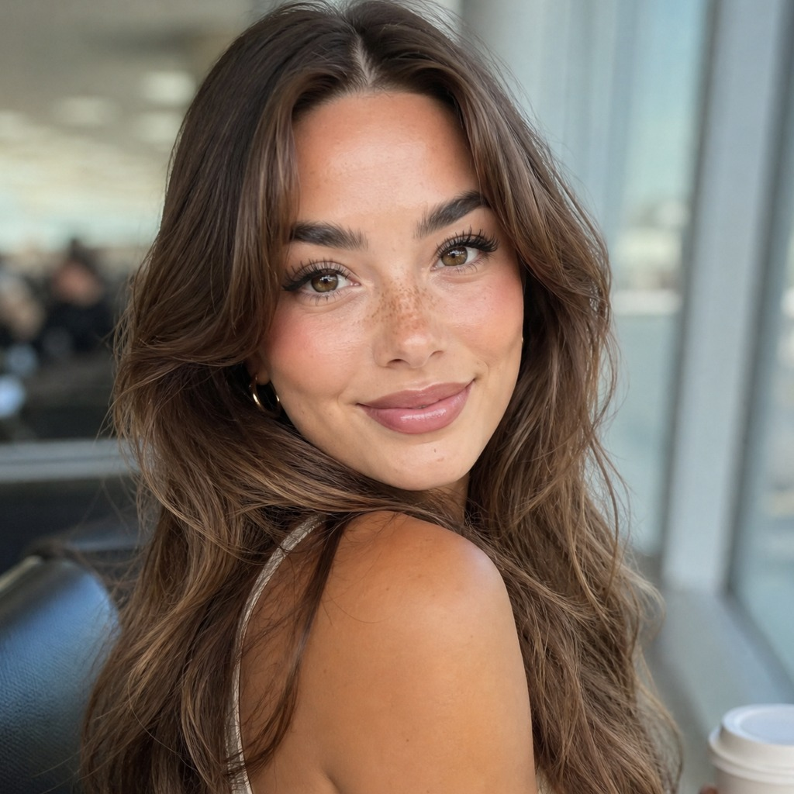
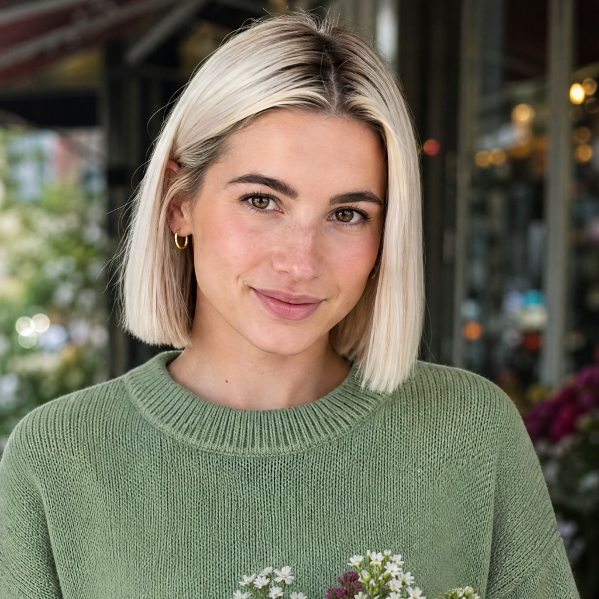

# 01 · Savanna (@SoSavvy)

Lark doc: https://ljpp9tldvzuk.jp.larksuite.com/docx/S35ZdSQcJojUpWxUJsnjD5dhp3f

Account group 1 of 10. One shared profile, four accounts: the original and three regen copies. Every account posts the same content; each copy only changes the name, handle, face and voice.

## Shared profile

Female - Performance marketer, tech- and social-media savvy, turned content creator

She always appears stylish and classy. She inspires marketers alike; She is satirical, works out, and has a creative designer boyfriend (AI persona Mike) whom she met at the agency she used to work for. 

#### Expanded bio

**Profile bio (short):** Ex-agency performance marketer turned creator, now running OOOMarketing from wherever we land ✈️ I turn ideas into finished videos, and I'll show you how (simply). ✨ Comment SPIRA.

**Who she is:** Savanna is in her mid-to-late twenties. She spent years as a performance marketer at a creative agency, running campaigns, chasing results and decoding what clients actually want. She and Mike left together to start OOOMarketing (Out of Office Marketing), their own marketing business, so they can work from anywhere and travel together. She creates for herself along the way. Her message: your best ideas shouldn't die in your notes app, and filming and editing are no longer an excuse. She shows people how she turns ideas into finished videos with Spira, explained so simply anyone can follow.

**Personality and voice:** Warm, bright and very expressive: big smile, lots of hand gestures, talks straight to camera like she's talking to a friend. She switches easily between three registers:

- **Motivating:** calm and sincere ("What if the scariest thing isn't posting something imperfect...").
- **Playful satire:** agency and client humour, teasing Mike, never mean.
- **Teacher mode:** breaks tech down to the simplest steps (the "explained in caveman" bit) and makes non-technical people feel smart ("Wow. You so techie.").

**Lifestyle:** Works out and keeps a disciplined routine, even on the road. Travels with Mike and works from wherever they land. Coffee in hand, laptop open, always busy but in control.

**Relationship:** Mike (AI persona) is a creative designer she met at the agency; they left together and now run OOOMarketing (Out of Office Marketing) as partners, so they can travel and work on the move. He wears glasses and has tousled, sun-bleached wavy hair. Their running joke is the marketer, the designer and the client. In the guessing-game skit she holds the "CLIENT" card, and he lists every client stereotype ("cheap", "spoiled brat", "drama queen") before the reveal. Natural duet and crossover content between the two accounts.

#### Content pillars

- **Start creating (motivation):** talking-head pieces on fear, perfectionism and ideas stuck in notes, ending on Spira as the way to start now.
- **Agency and client satire:** skits with Mike: guessing games, briefs, revisions, client archetypes.
- **Spira, explained simply:** step-by-step demos with on-screen UI (Spira CLI + Claude Code = finished videos), price shown and "no editing", ending with "Comment SPIRA".
- **Marketing that performs:** quick tips from her performance-marketing years: hooks, angles, what converts.
- **Her life:** workouts, workspace, coffee and routine, so people follow her as a person, not just for tips.
- **Out of office:** travelling with Mike and running OOOMarketing on the move: where they're working this week, client calls across time zones, and the real side of working while travelling.

#### Audience

Aspiring creators and marketers with ideas but no time or skills to film and edit, plus small business owners and freelancers who need content without an agency.

Account inspiration:

[@itsmariahbrunner](https://www.instagram.com/itsmariahbrunner/)

## Accounts

### Original · Savanna (@SoSavvy)

**Appearance:** Very long, straight honey-blonde hair with darker roots, worn half-up with the front pieces tucked back, falling to her waist. Hazel-brown eyes, light freckles, rosy cheeks and fresh makeup with soft winged liner and glossy pink lips. Chunky gold hoops are her everyday signature, dressed up with layered gold pieces. Slim. Sunglasses pushed up on her head outdoors; tortoiseshell glasses when she's in teacher mode.

**Wardrobe:** Classy, casual and put-together. Clean lines, fitted silhouettes and soft, quality fabrics with a polished, feminine edge: relaxed and effortless out and about, sleeker and more tailored on work nights, soft and cosy at home. Neutral palette: white, cream, black, brown, denim and gold.

**Voice ID:** to add

**Status:** handle not checked yet

Character sheet:

Character sheet URL: [https://static.viralwell.ai/assets/media/308864c5-67b4-47a3-9d2b-8aa8741308f1/generated-1793833203208-658b85ca-9526-46f0-bea9-6f21afef9808.png](https://static.viralwell.ai/assets/media/308864c5-67b4-47a3-9d2b-8aa8741308f1/generated-1793833203208-658b85ca-9526-46f0-bea9-6f21afef9808.png)

**Couple partner:** Mike (@makelikemike), Original of group 02 · Mike.

Partner character sheet URL: [https://static.viralwell.ai/assets/media/308864c5-67b4-47a3-9d2b-8aa8741308f1/generated-1793835040288-bc6f41d7-df9b-44f2-90b2-5b03eacbce70.png](https://static.viralwell.ai/assets/media/308864c5-67b4-47a3-9d2b-8aa8741308f1/generated-1793835040288-bc6f41d7-df9b-44f2-90b2-5b03eacbce70.png)

**When creating couple videos, use this as the male persona.**

### Regen 1 · Brook (@brookbrief)

**Appearance:** White American, 23. Long, glossy brunette hair in soft loose waves with face-framing layers, parted in the middle. Light freckles across her nose and cheeks, brown eyes, full brows, soft natural makeup with a nude-pink lip and small gold hoops.

**Wardrobe:** Classy, casual and put-together, with a fresh girl-next-door ease. Fitted clean basics and relaxed denim. Palette: cream, white, denim, brown and gold.

**Voice ID:** to add

**Status:** handle not checked yet

Character sheet:

Character sheet URL: [https://static.viralwell.ai/assets/media/308864c5-67b4-47a3-9d2b-8aa8741308f1/generated-1794412519875-b625d739-c74f-4fb2-a0be-6f0f0757794d.png](https://static.viralwell.ai/assets/media/308864c5-67b4-47a3-9d2b-8aa8741308f1/generated-1794412519875-b625d739-c74f-4fb2-a0be-6f0f0757794d.png)

**Couple partner:** Ethan (@itsmeethan), Regen 1 of group 02 · Mike.

Partner character sheet URL: [https://static.viralwell.ai/assets/media/86641e68-954b-412d-b3b5-e3710b105cbf/generated-1794233622846-f1bc95f5-7f76-49ce-9cf3-2946f61af37e.png](https://static.viralwell.ai/assets/media/86641e68-954b-412d-b3b5-e3710b105cbf/generated-1794233622846-f1bc95f5-7f76-49ce-9cf3-2946f61af37e.png)

**When creating couple videos, use this as the male persona.**

### Regen 2 · Zara (@zarascales)

**Appearance:** Lebanese-American, 24. Long, voluminous dark-brown hair in soft waves with face-framing layers, parted in the middle. Dark eyes, full defined brows, a warm smile, soft glam makeup with a rosy-nude lip and small gold hoops.

**Wardrobe:** Classy and sleek. Fitted tonal sets and clean lines with a polished, feminine edge. Palette: chocolate, black, cream and gold.

**Voice ID:** to add

**Status:** handle not checked yet

Character sheet:

Character sheet URL: [https://static.viralwell.ai/assets/media/308864c5-67b4-47a3-9d2b-8aa8741308f1/generated-1794412529191-58250a3e-63f1-48c9-9af3-df6abfc257c5.png](https://static.viralwell.ai/assets/media/308864c5-67b4-47a3-9d2b-8aa8741308f1/generated-1794412529191-58250a3e-63f1-48c9-9af3-df6abfc257c5.png)

**Couple partner:** Marc (@marc_o_polo), Regen 2 of group 02 · Mike.

Partner character sheet URL: [https://static-dev.viralwell.ai/assets/media/ab9d20cb-c47b-442b-aa39-386887dc361c/generated-1794365871005-58f9a44f-bec7-4c6c-af53-0eb30e793d2e.png](https://static-dev.viralwell.ai/assets/media/ab9d20cb-c47b-442b-aa39-386887dc361c/generated-1794365871005-58f9a44f-bec7-4c6c-af53-0eb30e793d2e.png)

**When creating couple videos, use this as the male persona.**

### Regen 3 · Alessia (@alessiasells)

**Appearance:** Italian-American, 25. A sleek platinum-blonde blunt bob to the jaw with darker roots, parted in the middle. Brown eyes, defined brows, a soft confident smile, fresh natural makeup and small gold hoops.

**Wardrobe:** Relaxed and polished. Cosy oversized knits over clean denim, effortless rather than glam. Palette: sage, cream, denim and gold.

**Voice ID:** to add

**Status:** handle not checked yet

Character sheet:

Character sheet URL: [https://static.viralwell.ai/assets/media/308864c5-67b4-47a3-9d2b-8aa8741308f1/generated-1794412528302-1e1ec5b1-3055-403b-a6ab-b4cdded80cf4.png](https://static.viralwell.ai/assets/media/308864c5-67b4-47a3-9d2b-8aa8741308f1/generated-1794412528302-1e1ec5b1-3055-403b-a6ab-b4cdded80cf4.png)

**Couple partner:** Rafael (@theaftermath), Regen 3 of group 02 · Mike.

Partner character sheet URL: [https://static-dev.viralwell.ai/assets/media/ab9d20cb-c47b-442b-aa39-386887dc361c/generated-1794367925927-18676583-4d9c-49ae-83ed-793d4fdf0398.png](https://static-dev.viralwell.ai/assets/media/ab9d20cb-c47b-442b-aa39-386887dc361c/generated-1794367925927-18676583-4d9c-49ae-83ed-793d4fdf0398.png)

**When creating couple videos, use this as the male persona.**

## Regen rules

- **Same for all four accounts:** the script, structure, hook, captions, content pillars and posting plan.
- **Changes per account:** the name and handle, the face (character sheet), the voice, and the background chosen for each video.
- **Never:** copies don't mention each other or the original.
