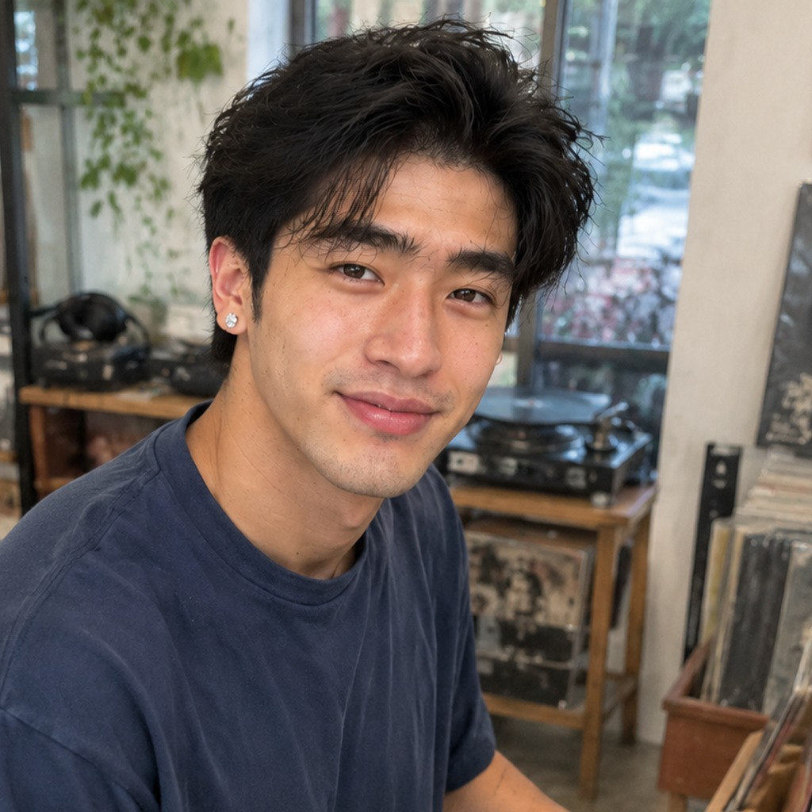
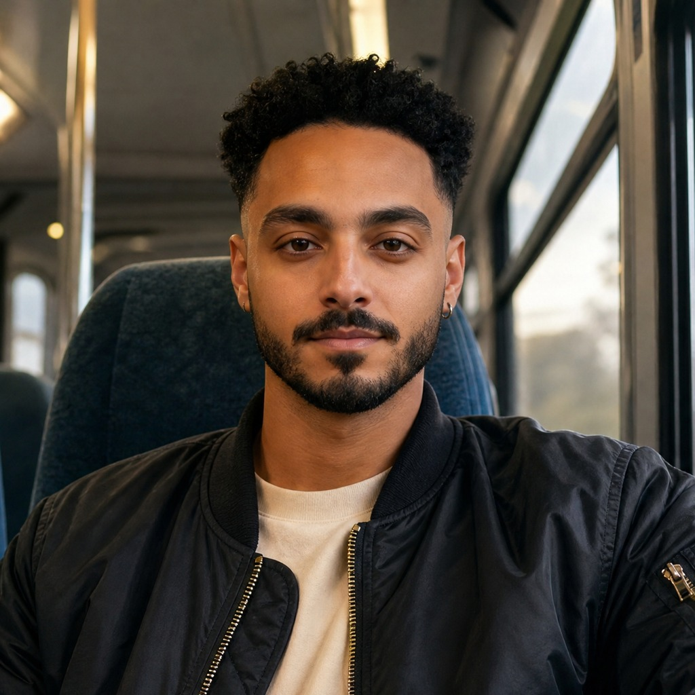
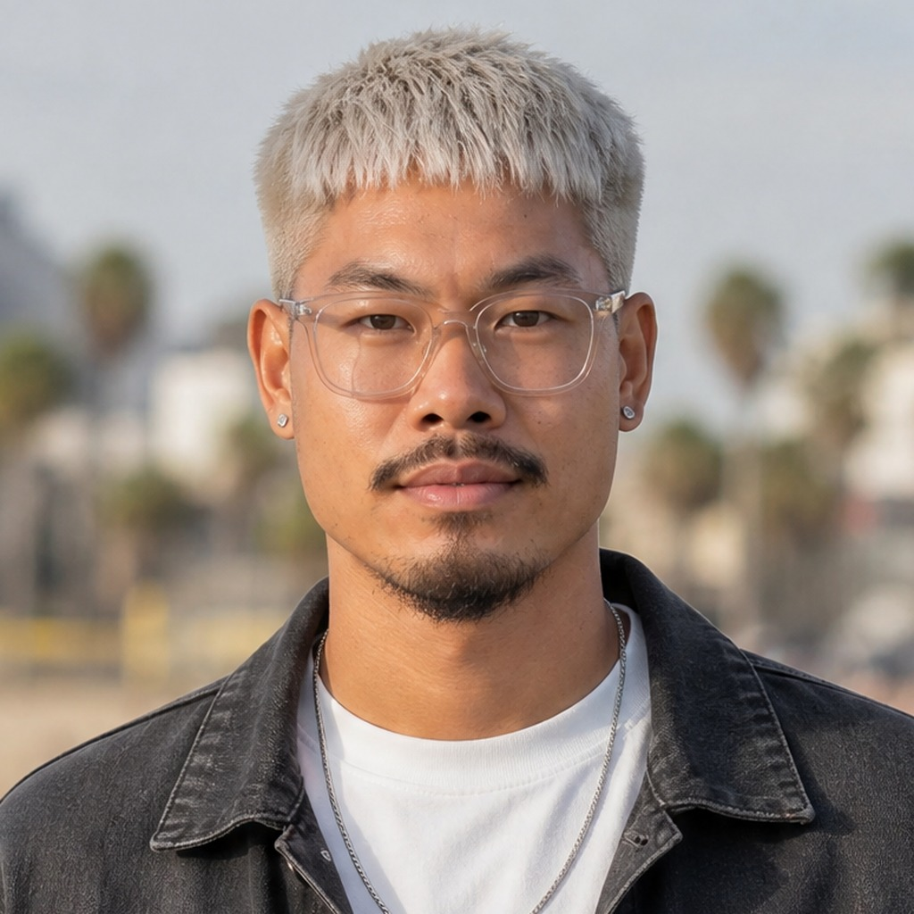

# 02 · Mike (@makelikemike)

Lark doc: https://ljpp9tldvzuk.jp.larksuite.com/docx/LWd7dCccwoLTaYxln4qj9qQNpyc

Account group 2 of 10. One shared profile, four accounts: the original and three regen copies. Every account posts the same content; each copy only changes the name, handle, face and voice.

## Shared profile

Male - Creative designer, ex-agency, now co-runs OOOMarketing (Out of Office Marketing) with his girlfriend Savanna

He is laid-back, a little clueless outside his craft and quietly obsessive about how things look. He met Savanna at the agency, and they left together to start OOOMarketing (Out of Office Marketing), their own marketing business, so they could travel and work on the move: she runs the strategy and targeting, he runs the creative. He's the straight face to her big reactions, and he usually gets the last line.

#### Expanded bio

**Profile bio (short):** Ex-agency designer, now co-running OOOMarketing with @SoSavvy from wherever we land ✈️ I make things look good and explain why. ✏️ Comment SPIRA.

**Who he is:** Mike is in his mid-twenties. He was a creative designer at the agency where he met Savanna, handling brand, social and motion work. They left together to start OOOMarketing (Out of Office Marketing) so they could work while they travel, and now the feedback rounds, the "can it pop more" and the briefs that change after the first draft land on him directly, and the clients are theirs. He thought AI would come for designers first. Instead, he spends more of his time on the idea and the craft. His message: the idea is the job, not the hours in the edit. He shows people how he turns his concepts into finished videos with Spira, the way he'd walk a client through a mood board.

**Personality and voice:** Relaxed, easy-going and dry. He has a slightly clueless, deadpan delivery (a relaxed 26-year-old American voice), and he rarely raises it. He switches between three registers:

- **Deadpan:** the straight man in skits with Savanna, calm while she gets more offended.
- **Designer nerd:** lights up when explaining type, spacing, colour and why a layout works.
- **Big reactions, rarely:** when something truly shocks him, the glasses come off and his jaw drops.

**Lifestyle:** Travels with Savanna and works from wherever they land, and finds a surf spot wherever he can. Carries a sketchbook everywhere and runs on coffee. He works late more than he'd like to admit.

**Relationship:** Savanna (@SoSavvy, AI persona) is a performance marketer he met at the agency. They left together and now run OOOMarketing (Out of Office Marketing) as partners in work and life, travelling while they work: she brings the strategy and targeting, he brings the creative. Their running joke is the marketer, the designer and the client: she thinks he's "a bit dramatic about fonts", and he thinks she says "just make it pop" like it's a brief. In the guessing-game skit he holds the "CLIENT" card to his forehead and lists every client stereotype ("cheap", "spoiled brat", "drama queen") before the reveal. Natural duet and crossover content between the two accounts.

#### Content pillars

- **Designer vs client satire:** "make the logo bigger", endless feedback rounds and briefs that make no sense, often with Savanna.
- **Design, explained:** quick before-and-after breakdowns of why something works: type, spacing, colour, hierarchy.
- **The converted sceptic:** a designer who expected AI to replace him, showing how he uses Spira to turn ideas into finished videos.
- **Duets with Savanna:** marketer vs designer skits, running a business with your partner, and couple content.
- **His life:** surfing, coffee, his sketchbook and late nights at the studio.
- **Out of office:** travelling with Savanna and designing on the move: the view from this week's desk, surf breaks between client calls, and how they run OOOMarketing from anywhere.

#### Audience

Designers, creatives and freelancers, small business owners and marketers who work with designers, and aspiring creators who care how their content looks.

## Accounts

### Original · Mike (@makelikemike)

**Appearance:** Tanned skin, light stubble and a big, easy smile. Tousled wavy hair, sun-bleached blonde on top with darker brown underneath, swept up and back. Thin light gold metal glasses with a slightly rounded rectangular frame, always on, and taken off only for shocked reactions.

**Wardrobe:** Relaxed and clean. Easy smart-casual layers with a creative edge: natural fabrics, relaxed fits and a lived-in, sun-washed feel. Palette: olive, white, cream, sand and denim.

**Voice ID:** to add

**Status:** handle not checked yet

Character sheet:

Character sheet URL: [https://static.viralwell.ai/assets/media/308864c5-67b4-47a3-9d2b-8aa8741308f1/generated-1793835040288-bc6f41d7-df9b-44f2-90b2-5b03eacbce70.png](https://static.viralwell.ai/assets/media/308864c5-67b4-47a3-9d2b-8aa8741308f1/generated-1793835040288-bc6f41d7-df9b-44f2-90b2-5b03eacbce70.png)

**Couple partner:** Savanna (@SoSavvy), Original of group 01 · Savanna.

Partner character sheet URL: [https://static.viralwell.ai/assets/media/308864c5-67b4-47a3-9d2b-8aa8741308f1/generated-1793833203208-658b85ca-9526-46f0-bea9-6f21afef9808.png](https://static.viralwell.ai/assets/media/308864c5-67b4-47a3-9d2b-8aa8741308f1/generated-1793833203208-658b85ca-9526-46f0-bea9-6f21afef9808.png)

**When creating couple videos, use this as the female persona.**

### Regen 1 · Ethan (@itsmeethan)

**Appearance:** Korean-American, 21, slim and tall. Thick, messy black hair with a textured fringe falling over his forehead. Dark brown eyes, clear skin, a strong jaw and a big, easy smile. Small stud earrings.

**Wardrobe:** Simple, cosy and college-student. Clean, soft-boy casual: relaxed fits, soft knits and easy layers, a little smarter for interviews and events. Palette: navy, black, grey, white and denim.

**Voice ID:** to add

**Status:** handle not checked yet

Character sheet:

Character sheet URL: [https://static.viralwell.ai/assets/media/86641e68-954b-412d-b3b5-e3710b105cbf/generated-1794233622846-f1bc95f5-7f76-49ce-9cf3-2946f61af37e.png](https://static.viralwell.ai/assets/media/86641e68-954b-412d-b3b5-e3710b105cbf/generated-1794233622846-f1bc95f5-7f76-49ce-9cf3-2946f61af37e.png)

**Couple partner:** Brook (@brookbrief), Regen 1 of group 01 · Savanna.

Partner character sheet URL: [https://static.viralwell.ai/assets/media/308864c5-67b4-47a3-9d2b-8aa8741308f1/generated-1794412519875-b625d739-c74f-4fb2-a0be-6f0f0757794d.png](https://static.viralwell.ai/assets/media/308864c5-67b4-47a3-9d2b-8aa8741308f1/generated-1794412519875-b625d739-c74f-4fb2-a0be-6f0f0757794d.png)

**When creating couple videos, use this as the female persona.**

### Regen 2 · Marc (@marc_o_polo)

**Appearance:** Light-skinned African-American, 28. Short dark curly hair with faded sides, a neat beard with a mustache, light brown skin and a small hoop earring.

**Wardrobe:** Relaxed and creative. Easy, street-smart layers with a filmmaker's ease, comfortable enough for long days on set. Palette: black, cream and earth tones.

**Voice ID:** to add

**Status:** handle not checked yet

Character sheet:

Character sheet URL: [https://static-dev.viralwell.ai/assets/media/ab9d20cb-c47b-442b-aa39-386887dc361c/generated-1794365871005-58f9a44f-bec7-4c6c-af53-0eb30e793d2e.png](https://static-dev.viralwell.ai/assets/media/ab9d20cb-c47b-442b-aa39-386887dc361c/generated-1794365871005-58f9a44f-bec7-4c6c-af53-0eb30e793d2e.png)

**Couple partner:** Zara (@zarascales), Regen 2 of group 01 · Savanna.

Partner character sheet URL: [https://static.viralwell.ai/assets/media/308864c5-67b4-47a3-9d2b-8aa8741308f1/generated-1794412529191-58250a3e-63f1-48c9-9af3-df6abfc257c5.png](https://static.viralwell.ai/assets/media/308864c5-67b4-47a3-9d2b-8aa8741308f1/generated-1794412529191-58250a3e-63f1-48c9-9af3-df6abfc257c5.png)

**When creating couple videos, use this as the female persona.**

### Regen 3 · Rafael (@theaftermath)

**Appearance:** Filipino-American, 27. Short platinum-dyed hair with a fringe and faded sides, clear-frame rectangular glasses, a thin mustache and goatee, a silver chain and a small stud earring.

**Wardrobe:** Streetwear. Boxy fits, washed and faded textures and his own brand's pieces, with a slightly edgy, garage-made feel. Palette: black, white, grey and silver.

**Voice ID:** to add

**Status:** handle not checked yet

Character sheet:

Character sheet URL: [https://static-dev.viralwell.ai/assets/media/ab9d20cb-c47b-442b-aa39-386887dc361c/generated-1794367925927-18676583-4d9c-49ae-83ed-793d4fdf0398.png](https://static-dev.viralwell.ai/assets/media/ab9d20cb-c47b-442b-aa39-386887dc361c/generated-1794367925927-18676583-4d9c-49ae-83ed-793d4fdf0398.png)

**Couple partner:** Alessia (@alessiasells), Regen 3 of group 01 · Savanna.

Partner character sheet URL: [https://static.viralwell.ai/assets/media/308864c5-67b4-47a3-9d2b-8aa8741308f1/generated-1794412528302-1e1ec5b1-3055-403b-a6ab-b4cdded80cf4.png](https://static.viralwell.ai/assets/media/308864c5-67b4-47a3-9d2b-8aa8741308f1/generated-1794412528302-1e1ec5b1-3055-403b-a6ab-b4cdded80cf4.png)

**When creating couple videos, use this as the female persona.**

## Regen rules

- **Always glasses (the owner, 2026-11-12):** Mike and every regen account (Ethan, Marc, Rafael) wear eyeglasses in every video.

- **Same for all four accounts:** the script, structure, hook, captions, content pillars and posting plan.
- **Changes per account:** the name and handle, the face (character sheet), the voice, and the background chosen for each video.
- **Never:** copies don't mention each other or the original.
