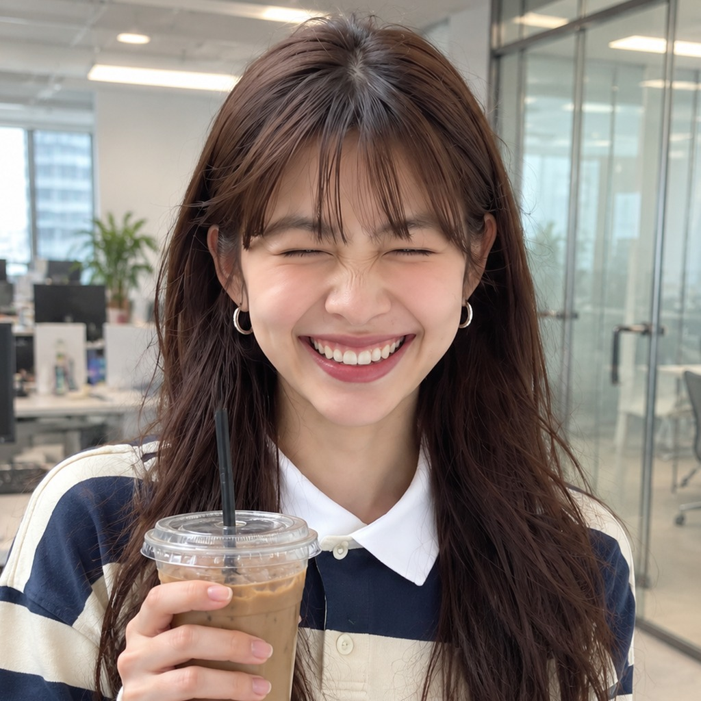
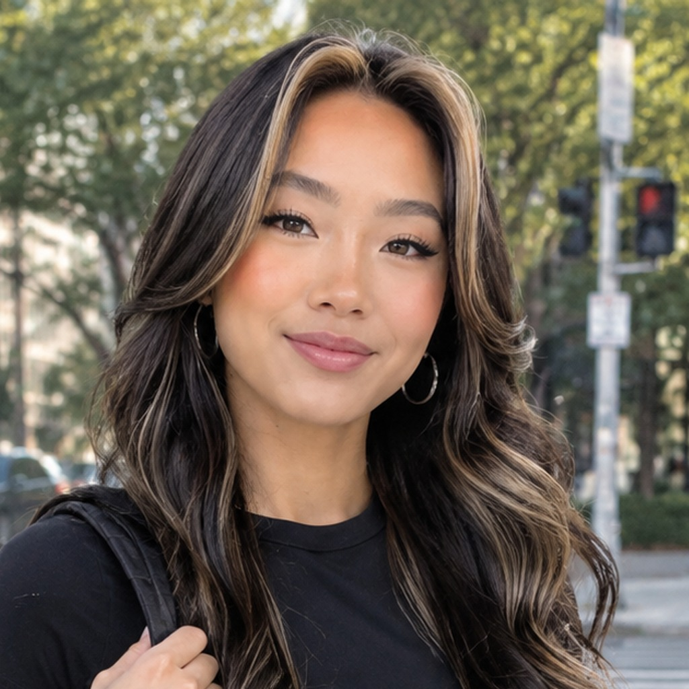

# 03 · Chloe (@chloediaries)

Lark doc: https://ljpp9tldvzuk.jp.larksuite.com/docx/W3R1d0kujoEqRKxG5gvjspdbpnh

Account group 3 of 10. One shared profile, four accounts: the original and three regen copies. Every account posts the same content; each copy only changes the name, handle, face and voice.

## Shared profile

Female - Tech sales account executive by day, fitness and lifestyle creator after 6pm

She is sporty, social and always up for a side quest. She sells software all day, trains for races at night, and turns the chaos of corporate life into relatable skits. Her motto: never try, never know.

#### Expanded bio

**Profile bio (short):** tech sales by day, side quests after 6pm 🏃🏻‍♀️ my ideas → finished videos, no editing. ✨ Comment SPIRA.

**Who she is:** Chloe is 23 and lives in Austin, Texas. A year out of college, she landed her first job as an account executive at a tech company: discovery calls, demos, quotas and a calendar with no gaps. Outside work she runs, trains for hybrid fitness races, hosts events, and travels whenever she can. She always had ideas for videos (office skits, training diaries, trip recaps) but no time to film and edit after a 10-hour day. Her message: being busy is not a reason to stop creating. She shows people how she turns ideas into finished videos with Spira, explained like a 30-second sales demo.

**Personality and voice:** High energy, loud laugh, big facial expressions, and very self-aware ("still dramatic mid-run"). She talks to camera like she's catching up with a friend after work. On camera she has three gears:

- **Motivating:** honest and upbeat, about going from "I hate running" to race day, signing up before you feel ready, and showing up on the bad days ("Never try, never know").
- **Corporate satire:** sales-life humour (the "quick sync", "circling back", the scariest thing at the office). Relatable, never mean.
- **Demo mode:** she explains Spira the way she'd pitch a client: the problem, the 3 steps, the result. Simple enough that anyone can follow, with a playful "any questions before I send the follow-up email?"

**Lifestyle:** Trains 5 to 6 days a week and always has a race on the calendar. Early mornings, long work days, then a run or a class. Weekends are for brunch, match days, nail appointments and booking the next trip.

#### Content pillars

**The owner's change (2026-11-15), applies to all four accounts and overrides the pillars below:** her content is no longer always about race training, which made her lines confusing. Her angle is a **tech SaaS side hustler**: a tech sales account executive by day who builds and grows her own small SaaS side project after hours (shipping features at night, first paying users, juggling the day job and the side hustle). Running and races are at most an occasional background detail, never the point. On-screen text, captions and hashtags are about the SaaS side hustle.

- **Corporate and sales satire:** skits about calls, demos, quotas, the boss, the client, and office Halloween ("wear your scariest costume").
- **Spira, pitched like a demo:** demo-style videos with on-screen UI showing how she turns an idea into a finished video with Spira in a few steps, "no editing", ending with "Comment SPIRA".
- **Training diaries:** honest race build-ups, bad-day runs, first-race nerves and finish-line moments, so people feel they can start too.
- **Her life:** travel, match days, events she hosts, nails and weekend side quests.

#### Audience

Busy young professionals (especially in tech, sales and corporate jobs) who want to post but have no time to film and edit, plus fitness and lifestyle fans who love relatable work humour. Core market: the US.

Account inspiration:

https://www.instagram.com/nicolettecallie/

## Accounts

### Original · Chloe (@chloediaries)

**Appearance:** East Asian-American, 20, petite. Shoulder-length, straight black hair with soft, wispy bangs. Dark brown eyes, fair skin, rosy cheeks and fresh makeup with soft liner and a tinted lip. Small pearl stud earrings and layered gold necklaces.

**Wardrobe:** Comfy, cute and student-budget. Cosy, oversized layers and simple basics for campus, soft loungewear for late-night study videos, and one smart step up for career fairs. Palette: grey, white, cream, sage and denim.

**Voice ID:** to add

**Status:** handle not checked yet

Character sheet:

Character sheet URL: [https://static.viralwell.ai/assets/media/86641e68-954b-412d-b3b5-e3710b105cbf/generated-1794228664029-717b2a48-97e3-4bfc-a7b1-681022d7fb7d.png](https://static.viralwell.ai/assets/media/86641e68-954b-412d-b3b5-e3710b105cbf/generated-1794228664029-717b2a48-97e3-4bfc-a7b1-681022d7fb7d.png)

### Regen 1 · Jessica (@jessicaxoxo)

**Appearance:** Asian-American, mid-twenties, slim. Long dark-brown hair with wispy full bangs, worn down, or in a high ponytail or two buns for workouts. Fair skin, dark brown eyes, a wide, bright smile and rosy cheeks, with light, fresh makeup. Small silver hoop earrings. Signature chrome nails and a sports watch on her wrist, even at the office.

**Wardrobe:** Sporty by default, polished when needed. Performance athleisure for training, sleek and confident for the office, and a little glam for events and nights out. Palette: black, white, red, grey and chrome.

**Voice ID:** to add

**Status:** handle not checked yet

Character sheet:

Character sheet URL: [https://static.viralwell.ai/assets/media/86641e68-954b-412d-b3b5-e3710b105cbf/generated-1794147929479-8271e056-56e2-4135-8956-ee643997565e.png](https://static.viralwell.ai/assets/media/86641e68-954b-412d-b3b5-e3710b105cbf/generated-1794147929479-8271e056-56e2-4135-8956-ee643997565e.png)

### Regen 2 · Hana (@hana.banana)

**Appearance:** East Asian-American, 23. Very long, sleek straight black hair, parted in the middle. Soft features, dark brown eyes, fresh natural makeup and small silver studs.

**Wardrobe:** Clean and minimal. Simple fitted basics and relaxed denim, effortless and neat. Palette: white, light denim, grey and silver.

**Voice ID:** to add

**Status:** handle not checked yet

Character sheet:

Character sheet URL: [https://static.viralwell.ai/assets/media/308864c5-67b4-47a3-9d2b-8aa8741308f1/generated-1794413929943-e97f86bc-4d45-4aec-ad10-5458862f1f65.png](https://static.viralwell.ai/assets/media/308864c5-67b4-47a3-9d2b-8aa8741308f1/generated-1794413929943-e97f86bc-4d45-4aec-ad10-5458862f1f65.png)

### Regen 3 · Tiffany (@mustluv.tiff)

**Appearance:** Korean-American, 23. Long dark hair with ash-blonde face-framing highlights in big blowout waves. Sharp winged liner, wispy lashes, a soft closed-mouth smile and small silver hoops.

**Wardrobe:** Y2K going-out style. Fitted cropped tops, low-rise baggy denim and chunky sneakers. Palette: black, light denim, white and silver.

**Voice ID:** to add

**Status:** handle not checked yet

Character sheet:

Character sheet URL: [https://static.viralwell.ai/assets/media/308864c5-67b4-47a3-9d2b-8aa8741308f1/generated-1794415065014-a4142d4c-59da-4c24-87ad-de2c5bc4477b.png](https://static.viralwell.ai/assets/media/308864c5-67b4-47a3-9d2b-8aa8741308f1/generated-1794415065014-a4142d4c-59da-4c24-87ad-de2c5bc4477b.png)

## Regen rules

- **Same for all four accounts:** the script, structure, hook, captions, content pillars and posting plan.
- **Changes per account:** the name and handle, the face (character sheet), the voice, and the background chosen for each video.
- **Never:** copies don't mention each other or the original.
