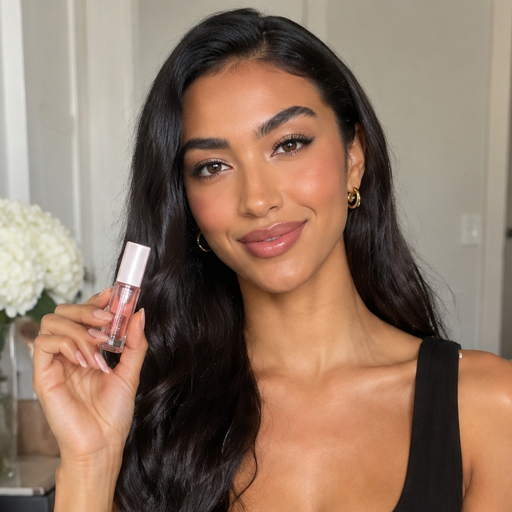
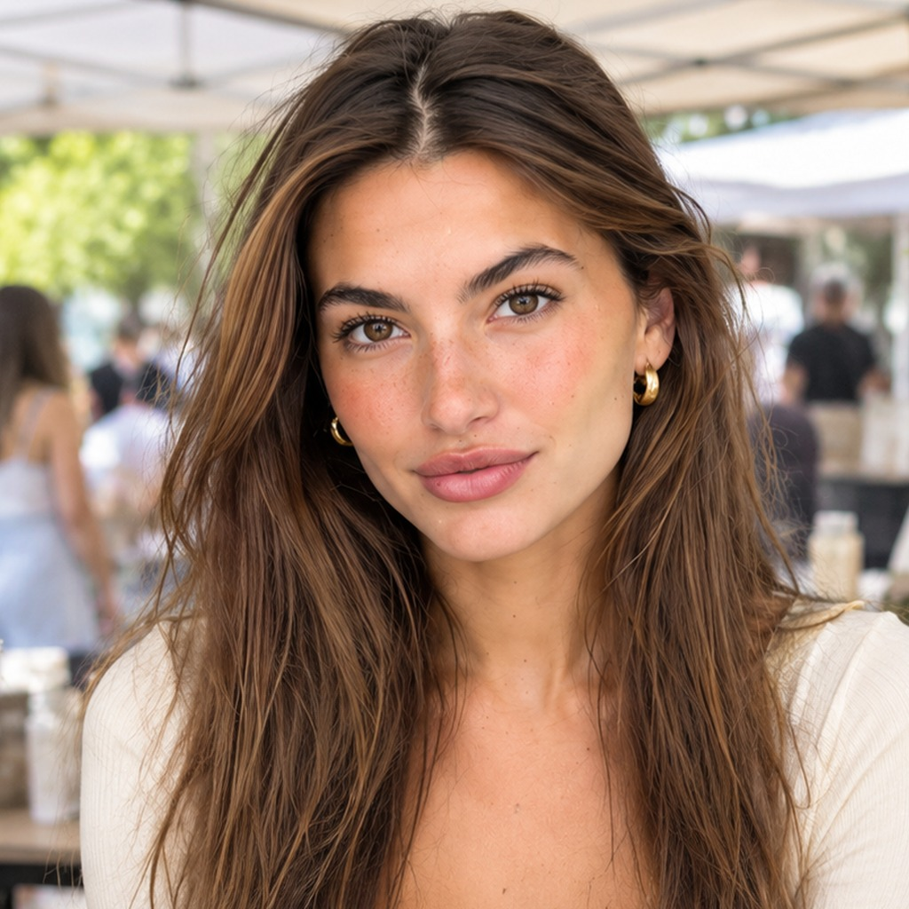
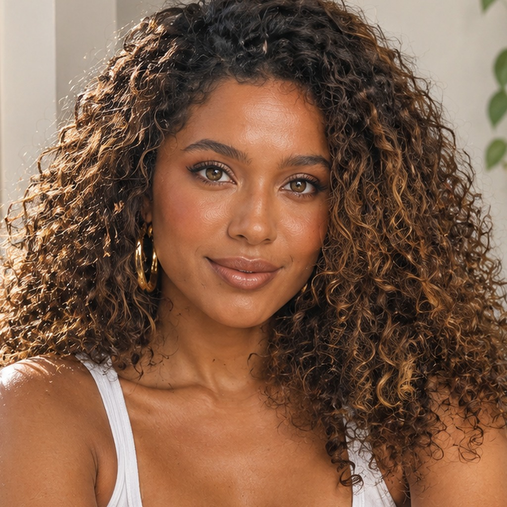
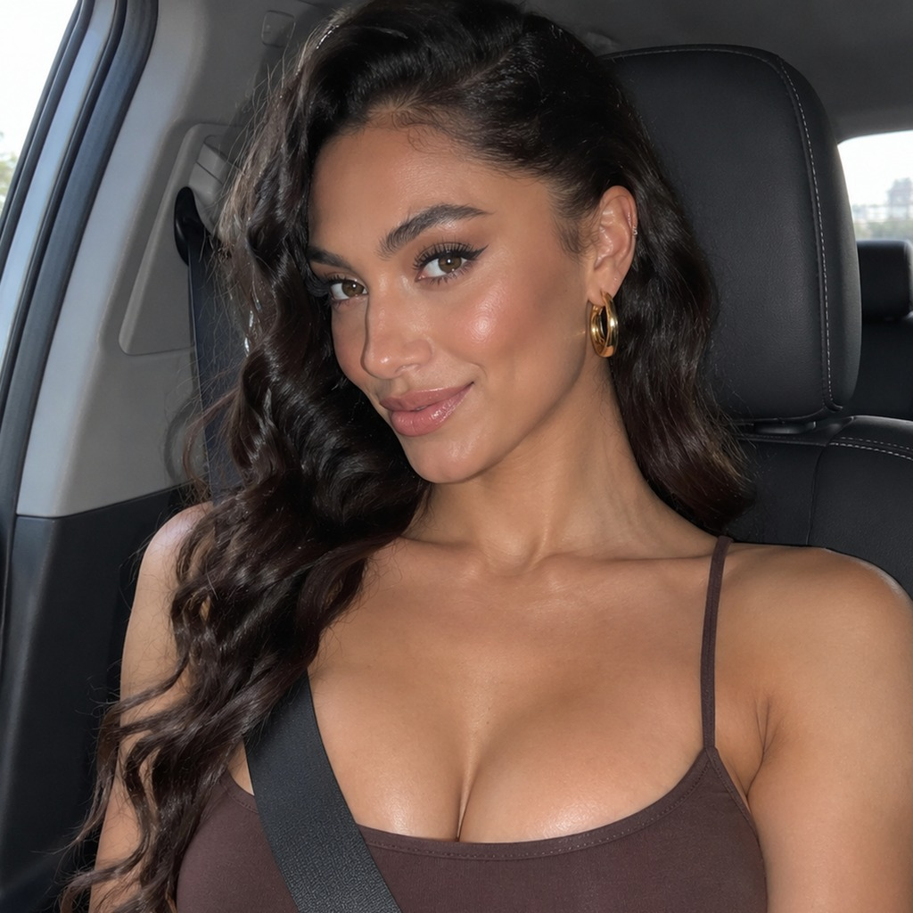

# 04 · Itzel (@itzelbeauty)

Lark doc: https://ljpp9tldvzuk.jp.larksuite.com/docx/MI1CdCMpFoaHGAxQ0pbjNri7pGg

Account group 4 of 10. One shared profile, four accounts: the original and three regen copies. Every account posts the same content; each copy only changes the name, handle, face and voice.

## Shared profile

Female - Model turned founder of her own lip-oil line, sharing beauty, fashion and the business behind it

She always looks camera-ready without trying. She inspires young women who want to turn their beauty and style know-how into a brand of their own. She is warm, glowing and a little chaotic on launch days.

#### Expanded bio

**Profile bio (short):** 22. ex-model 📸 made a lip oil, now I make the videos too. Building it in public. 💄 Comment SPIRA.

**Who she is:** Itzel is 22, Mexican-American, and started modelling at 18: e-commerce shoots, beauty campaigns and long days in the makeup chair. She soaked up every trick the makeup artists and stylists taught her, and turned it into her own lip-oil line, launched from her apartment. She does the product, the packing and the content, and shares the honest version: the sell-outs and the slow weeks. The catch: between shoots, orders and packing, there is no time left to edit. Her message: you can build a brand from your bedroom, and the content doesn't have to wait until you have a team. She shows people how she turns a product idea into finished videos with Spira, between packing orders.

**Personality and voice:** Warm, bright and expressive, talks to camera like it's her best friend on FaceTime. She switches between three registers:

- **Founder honesty:** the real numbers of a small launch, the wins and the boxes in the hallway.
- **Model secrets:** the beauty, styling and posing tricks she learned on set, explained in 30 seconds.
- **Founder how-to:** how she makes one product video in minutes.

**Lifestyle:** Pilates three times a week, skincare every night, always one more box to pack.

#### Content pillars

- **Building in public:** the real story of a small beauty brand.
- **Model-tested beauty and style:** makeup, outfits and posing tips from her years in front of the camera.
- **Product to post:** a product script turned into a finished video with Maxima, then posted on schedule.
- **Beauty that sells:** hooks and angles from her own product videos.
- **Her life:** shoots, Pilates, skincare and packing.

#### Audience

Young women into beauty and fashion, aspiring models, and creators who want to start a product brand of their own.

## Accounts

### Original · Itzel (@itzelbeauty)

**Appearance:** Long glossy black waves, warm tan skin, soft brown eyes, fresh glowing makeup and small gold hoops. Slim, toned fashion-model figure.

**Wardrobe:** Clean and feminine. Fitted, minimal silhouettes with soft, glowing textures: effortless on packing days and a little more glam on launch nights. Palette: black, cream, tan and gold.

**Voice ID:** to add

**Status:** handle not checked yet

Character sheet:

Character sheet URL: [https://static.viralwell.ai/assets/media/308864c5-67b4-47a3-9d2b-8aa8741308f1/uploads/1794402625675-97fd4513-7e6d-4649-9ba9-51257c88eded.jpg](https://static.viralwell.ai/assets/media/308864c5-67b4-47a3-9d2b-8aa8741308f1/uploads/1794402625675-97fd4513-7e6d-4649-9ba9-51257c88eded.jpg)

### Regen 1 · Nicole (@nicoluv)

**Appearance:** Brazilian-American, mid-twenties, slim. Long, glossy brown hair with caramel highlights, soft waves and a middle part, worn down. Warm olive skin, brown eyes, full brows and a soft, natural glam look with a nude-pink lip. Small gold huggie earrings. Long almond nails (always done), a dainty gold necklace and a gold watch.

**Wardrobe:** Elevated, feminine and a little bit extra. Fitted, flattering silhouettes and soft textures like lace and silk: Miami glam for going out and effortless comfort for late-night skits. Palette: white, cream, black, gold and soft pink.

**Voice ID:** to add

**Status:** handle not checked yet

Character sheet:

Character sheet URL: [https://static.viralwell.ai/assets/media/86641e68-954b-412d-b3b5-e3710b105cbf/generated-1794221243880-a485ce57-7697-46f3-9088-f68c188621e4.png](https://static.viralwell.ai/assets/media/86641e68-954b-412d-b3b5-e3710b105cbf/generated-1794221243880-a485ce57-7697-46f3-9088-f68c188621e4.png)

### Regen 2 · Valeria (@ValeriaPlans)

**Appearance:** Colombian-American, 23, slim, athletic and toned. Long, voluminous chestnut-brown curls with caramel highlights, caramel skin, high cheekbones, dark-brown almond eyes, full lips and gold hoop earrings.

**Wardrobe:** Trend-led basics. Fresh, fitted, on-trend everyday pieces, a little sharper for the office and coordinated at the weekend. Palette: white, light denim, beige and gold.

**Voice ID:** to add

**Status:** handle not checked yet

Character sheet:

Character sheet URL: [https://static.viralwell.ai/assets/media/308864c5-67b4-47a3-9d2b-8aa8741308f1/uploads/1794402628352-e9e45768-71b1-470c-a37b-05c99f7b7815.jpg](https://static.viralwell.ai/assets/media/308864c5-67b4-47a3-9d2b-8aa8741308f1/uploads/1794402628352-e9e45768-71b1-470c-a37b-05c99f7b7815.jpg)

### Regen 3 · Daniela (@DaniMovesDaily)

**Appearance:** Long, glossy dark-brown hair in loose waves, often swept to one side, caramel-tan skin, defined brows, a bright smile and gold hoops. Slim, curvy and athletic: a small waist and a toned, curvy figure.

**Wardrobe:** Fitted and sporty. Body-confident, sleek silhouettes, matching athletic sets for training and comfy, relaxed fits on rest days. Palette: chocolate brown, black, neutrals and gold.

**Voice ID:** to add

**Status:** handle not checked yet

Character sheet:

Character sheet URL: [https://static.viralwell.ai/assets/media/308864c5-67b4-47a3-9d2b-8aa8741308f1/uploads/1794402630291-3e4a7ea9-f748-444d-87e6-d926513e0bdd.jpg](https://static.viralwell.ai/assets/media/308864c5-67b4-47a3-9d2b-8aa8741308f1/uploads/1794402630291-3e4a7ea9-f748-444d-87e6-d926513e0bdd.jpg)

## Regen rules

- **Same for all four accounts:** the script, structure, hook, captions, content pillars and posting plan.
- **Changes per account:** the name and handle, the face (character sheet), the voice, and the background chosen for each video.
- **Never:** copies don't mention each other or the original.
