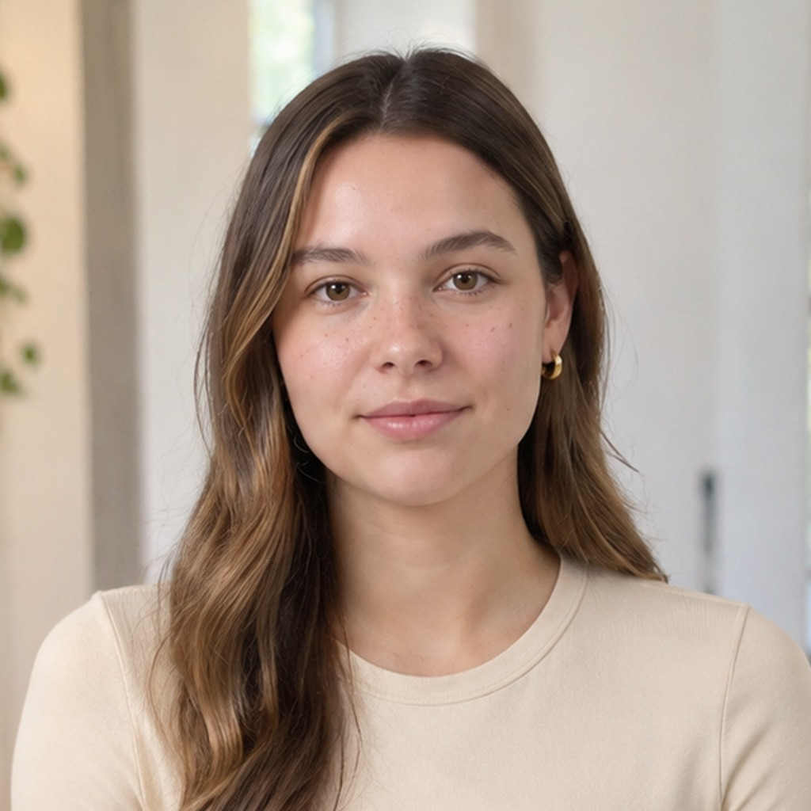
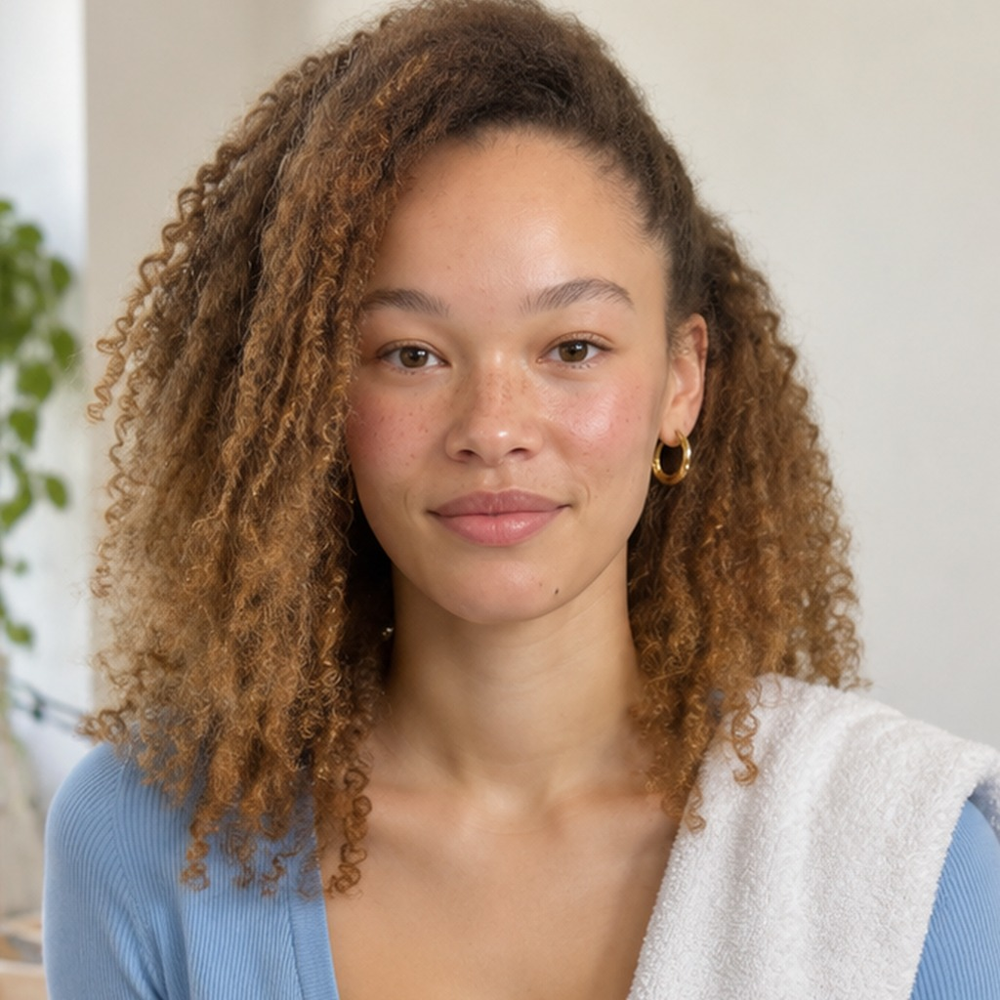
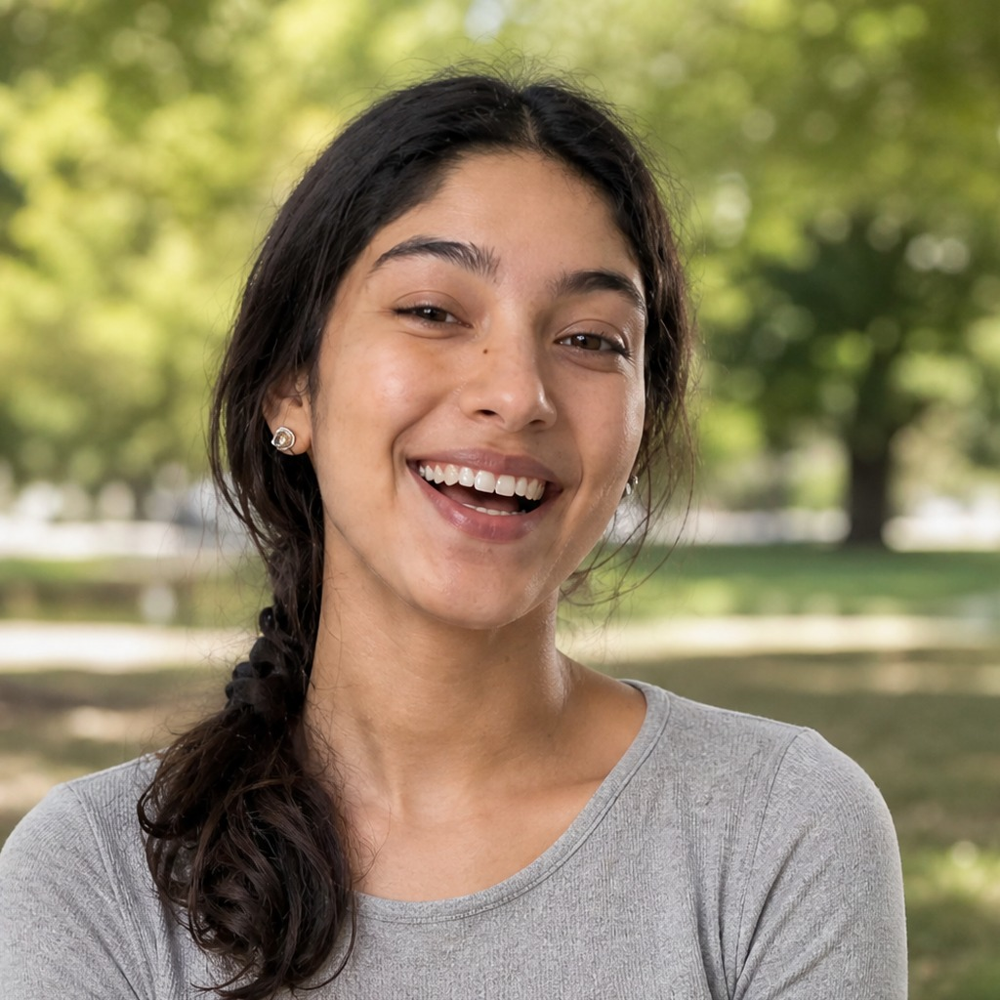
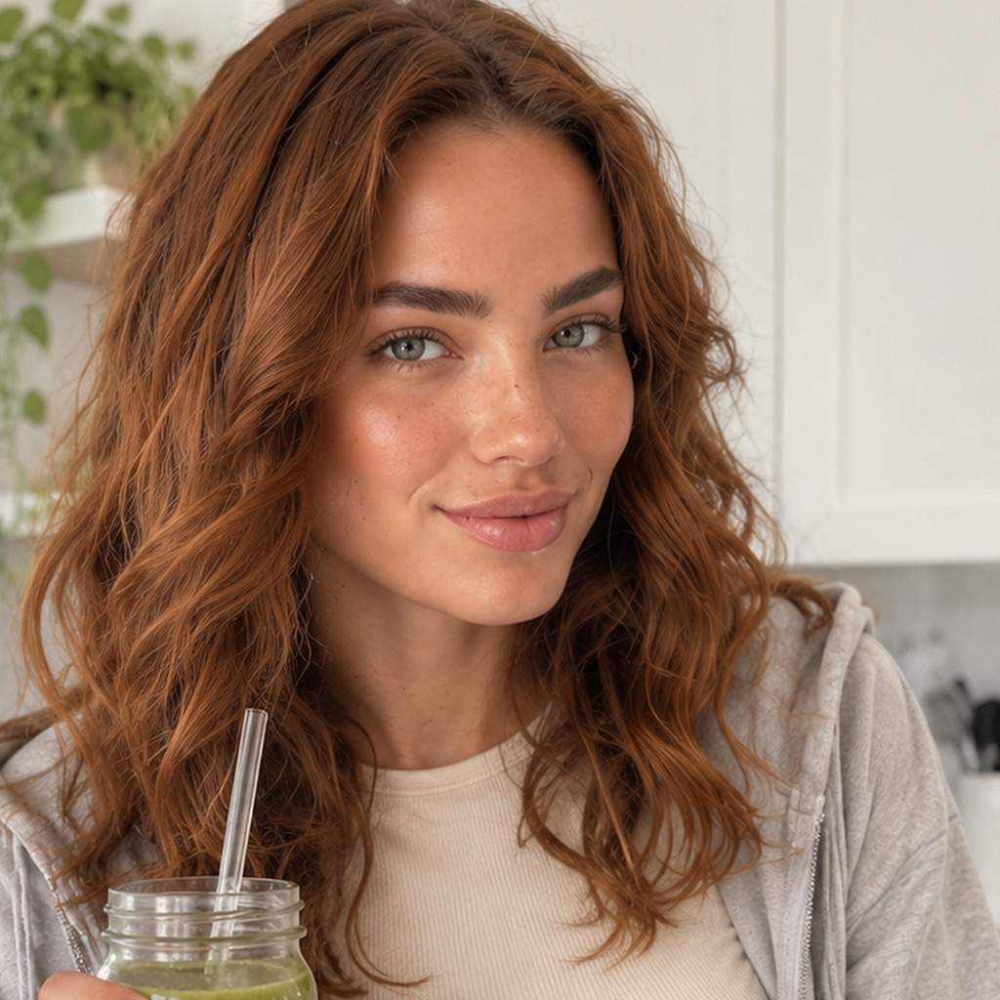

# 05 · Hannah (@corewithhannah)

Lark doc: https://ljpp9tldvzuk.jp.larksuite.com/docx/Ap8wd4YPQoI59Hx7xJpjOVbbp9b

Account group 5 of 10. One shared profile, four accounts: the original and three regen copies. Every account posts the same content; each copy only changes the name, handle, face and voice.

## Shared profile

Female - Founder of a boutique pilates studio who runs five accounts with Spira

She always looks calm and studio-ready. She inspires small-business owners who have no time for content. She is warm and organised, quietly frazzled behind the front desk, and dry and funny about owning a studio.

#### Expanded bio

**Profile bio (short):** I own a pilates studio and I haven't slept since 2023 🧘‍♀️ Comment SPIRA.

**Who she is:** Hannah is 29, White American, and lives in Los Angeles. She taught pilates for six years before opening her own studio in Silver Lake. Between classes, staff and payroll there was no time left for content, so she set up five accounts on Spira's Automated Channels (the studio, beginner tips and three niche channels) and now spends one hour a day on all of them. Her message: your business deserves content, even when you have no time to make it. She shows other owners how her one-hour workflow runs on Spira, between classes at the studio.

**Personality and voice:** Calm, warm and organized in front of clients, quietly frazzled behind the front desk. She's a recovering people-pleaser who used to say yes to every class request and collab, and she talks openly about learning to protect her time and her energy. Her dry humor about owning a small business ("I teach breathing for a living and forget to do it") keeps her content relatable for other founders. She has three sides on camera:

- **Studio calm:** warm, clear pilates tips for beginners.
- **Small-business humour:** dry jokes about owning a studio ("I teach breathing for a living and forget to do it").
- **Front-desk workflow:** her one-hour content workflow on Spira's Automated Channels.

**Lifestyle:** Classes, staff and payroll all day, one hour a day for content. A recovering people-pleaser learning to protect her time and energy.

#### Content pillars

**The owner's change (2026-11-15), applies to all four accounts and overrides the pillars below:** her content is no longer always about pilates. Her angle is a **vlogger and streamer**: she vlogs her days and goes live, sharing what's happening in her life, chatting with her audience, behind-the-scenes and day-in-the-life moments. Pilates and her studio are at most an occasional background detail, never the point. On-screen text, captions and hashtags are about her vlogging and streaming life.

- **Small-business owner humour:** the frazzled side of running a studio.
- **1-hour content workflow:** how five accounts run in one hour a day.
- **Studio life:** classes, staff and the studio behind the scenes.
- **Five accounts, one hour:** Spira's Automated Channels on screen, ending with "Comment SPIRA".

#### Audience

Studio owners, fitness instructors and small-business owners with no time for content.

## Accounts

### Original · Hannah (@corewithhannah)

**Appearance:** White American, 29. Long brunette waves with lighter ends, a friendly girl-next-door face with light freckles and small gold huggie earrings.

**Wardrobe:** Soft and sporty. Clean, fitted studio wear and soft ribbed textures, calm and put-together. Palette: cream, white, beige and gold.

**Voice ID:** to add

**Status:** handle not checked yet

Character sheet:

Character sheet URL: [https://static-dev.viralwell.ai/assets/media/ab9d20cb-c47b-442b-aa39-386887dc361c/generated-1794366880583-8018c4d3-ab8e-4c18-bf68-03b053e18f54.png](https://static-dev.viralwell.ai/assets/media/ab9d20cb-c47b-442b-aa39-386887dc361c/generated-1794366880583-8018c4d3-ab8e-4c18-bf68-03b053e18f54.png)

### Regen 1 · Nia (@niaturally)

**Appearance:** Light-skinned African-American, 25. Shoulder-length honey-brown natural curls, light brown skin with freckles, minimal makeup and gold hoops.

**Wardrobe:** Soft and bright. Fresh, cosy layers and simple basics in soft pastels, approachable and camera-ready. Palette: baby blue, white, cream and gold.

**Voice ID:** to add

**Status:** handle not checked yet

Character sheet:

Character sheet URL: [https://static-dev.viralwell.ai/assets/media/ab9d20cb-c47b-442b-aa39-386887dc361c/generated-1794371809243-6cfd64de-a7e8-462e-9c43-8f97b36d3c24.png](https://static-dev.viralwell.ai/assets/media/ab9d20cb-c47b-442b-aa39-386887dc361c/generated-1794371809243-6cfd64de-a7e8-462e-9c43-8f97b36d3c24.png)

### Regen 2 · Leena (@Leena.on.me)

**Appearance:** South Asian American, late twenties with a youthful look. Long dark hair in a loose low braid-ponytail, parted in the middle. Soft features, a soft round face, natural brows, a small beauty mark, a fresh bare face and small silver studs.

**Wardrobe:** Soft sporty studio wear. Fitted ribbed layers, leggings and clean sneakers, simple and comfortable. Palette: heather grey, black, white and silver.

**Voice ID:** to add

**Status:** handle not checked yet

Character sheet:

Character sheet URL: [https://static.viralwell.ai/assets/media/308864c5-67b4-47a3-9d2b-8aa8741308f1/generated-1794417085142-4a653b2d-9a3a-4439-970c-a0c1f7de6eea.png](https://static.viralwell.ai/assets/media/308864c5-67b4-47a3-9d2b-8aa8741308f1/generated-1794417085142-4a653b2d-9a3a-4439-970c-a0c1f7de6eea.png)

### Regen 3 · Keira (@redhotpeppergirl)

**Appearance:** Irish American, 30. Shoulder-length wavy auburn hair. Soft features, grey-green eyes, light freckles and a soft closed-mouth smile.

**Wardrobe:** Cosy sporty. Soft ribbed crop tops under zip hoodies with relaxed joggers. Palette: cream, light grey and white.

**Voice ID:** to add

**Status:** handle not checked yet

Character sheet:

Character sheet URL: [https://static.viralwell.ai/assets/media/308864c5-67b4-47a3-9d2b-8aa8741308f1/generated-1794417310411-1dc03908-b9b7-4a65-8574-86987ff2a61d.png](https://static.viralwell.ai/assets/media/308864c5-67b4-47a3-9d2b-8aa8741308f1/generated-1794417310411-1dc03908-b9b7-4a65-8574-86987ff2a61d.png)

## Regen rules

- **Same for all four accounts:** the script, structure, hook, captions, content pillars and posting plan.
- **Changes per account:** the name and handle, the face (character sheet), the voice, and the background chosen for each video.
- **Never:** copies don't mention each other or the original.
