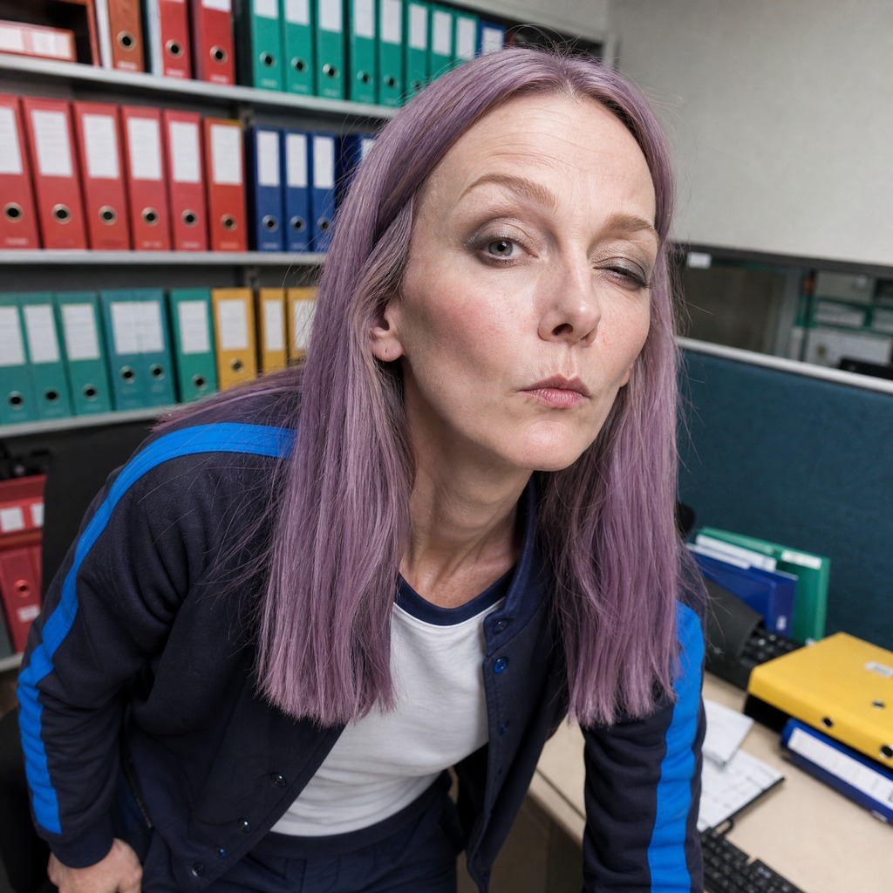
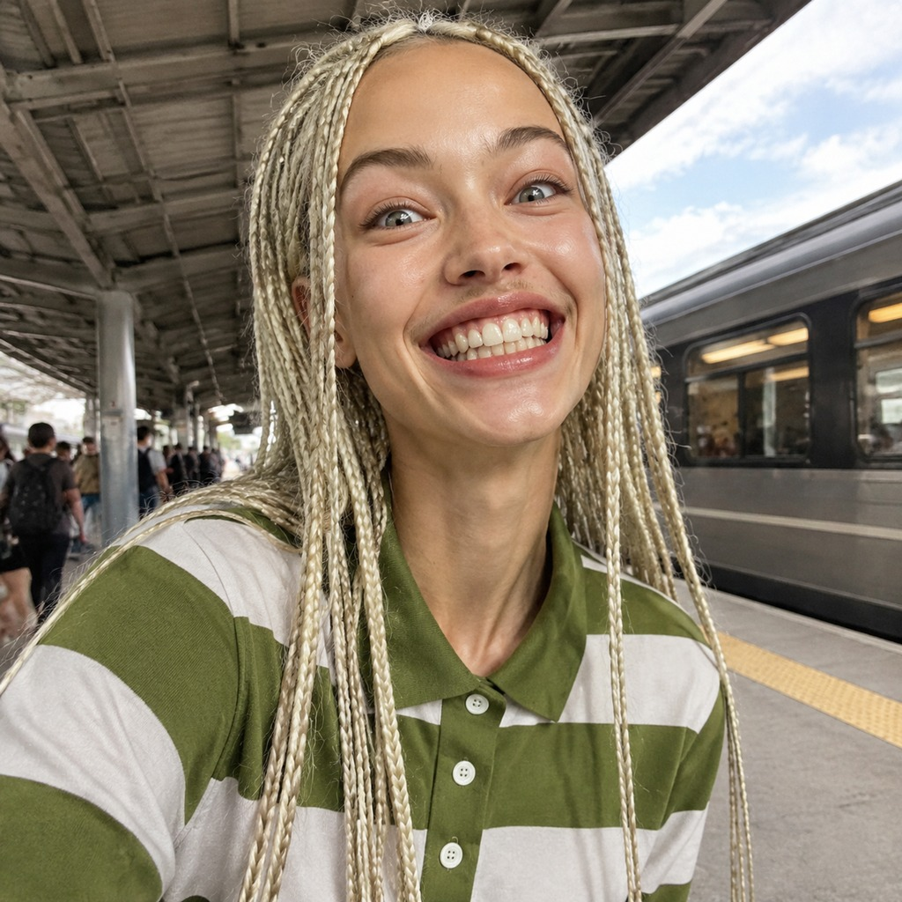

# 06 · Mabel (@MabelOnFile)

Lark doc: https://ljpp9tldvzuk.jp.larksuite.com/docx/N8ACdi5VSoFoVsxvNBEj4UfJpPe

Account group 6 of 10. One shared profile, four accounts: the original and three regen copies. Every account posts the same content; each copy only changes the name, handle, face and voice.

## Shared profile

Female - Marketing coordinator who has colour-coded everything, including her feelings

She always looks like she was laminated this morning. She inspires anyone who has ever been asked to "just jump on a quick call". She is bone-dry, terrifyingly organised and secretly very kind.

#### Expanded bio

**Profile bio (short):** Marketing coordinator. Colour-coded since birth. My planner has a planner. 🗂️ Comment SPIRA.

**Who she is:** Mabel is in her early thirties, or so she says; nobody at the agency has ever found her birthday in the calendar. She has coordinated marketing at the same small creative agency for eight years, keeps three paper planners and a spreadsheet to track the planners, and once colour-coded the office fire drill. She started posting after a client asked "can you make it go viral?" for the ninth time, and she answered on camera without blinking. The catch: her calendar is booked in 15-minute blocks until 2031, and "editing" was never one of them. Her message: chaos is just a plan nobody has written down yet. She shows people how she plans and makes the agency's content with Spira, one tidy checklist at a time.

**Personality and voice:** Bone-dry, precise and quietly kind. Almost no facial movement, perfect timing and a single raised brow that has ended entire meetings. Her face does three things, very slowly:

- **Deadpan weather report:** agency life read out like a forecast ("Monday. The brief changed. Again. Light drizzle of feedback.").
- **Order as comedy:** tiny victories of organisation played completely straight, like labelling the label maker.
- **The calm fix:** the one sensible step that saves a messy week.

**Lifestyle:** Up at 6:00, planner at 6:15, tea at 6:16. Long walks at exactly the same pace every day. Has never once been on "a quick call".

#### Content pillars

- **Order in chaos:** planning rituals and the one system that saves a messy week.
- **Agency satire:** briefs, revisions, "small tweaks" and meetings that could have been an email.
- **Spira, done properly:** planning a week in the calendar and approving posts in the review queue before 9:00.
- **Coordinator tips:** approvals, naming files and saying no politely.
- **Her life:** planners, tea, walks and alarmingly organised weekends.

#### Audience

Marketing coordinators, assistants and anyone who keeps a team on schedule.

## Accounts

### Original · Mabel (@MabelOnFile)

**Appearance:** A towering platinum-blonde beehive, huge ice-blue eyes behind oval wire glasses, thin high arched brows, a tiny pursed mouth, a long slender neck and porcelain skin. Slim.

**Comic traits to retain from the reference (the owner, 2026-11-12):** a sky-high platinum-blonde beehive, huge ice-blue eyes behind oval wire glasses, thin high arched brows, a tiny pursed mouth and a very long slender neck; slim. Keep them exactly as on the character sheet: do not exaggerate, soften or change them, and keep the face, nose and eyes as they are.

**Wardrobe:** Retro office, always pressed. Neat, buttoned-up, 1960s-inspired tailoring with crisp pleats and polished, old-fashioned details, never a crease out of place. Palette: burgundy, mint, grey, beige and white.

**Voice ID:** to add

**Status:** handle not checked yet

Character sheet:

Character sheet URL: [https://static.viralwell.ai/assets/media/308864c5-67b4-47a3-9d2b-8aa8741308f1/uploads/1794402617086-1336f5bd-9fbf-4e85-ab66-e106ae55e6f4.jpg](https://static.viralwell.ai/assets/media/308864c5-67b4-47a3-9d2b-8aa8741308f1/uploads/1794402617086-1336f5bd-9fbf-4e85-ab66-e106ae55e6f4.jpg)

### Regen 1 · Doris (@Dorkiiiis)

**Appearance:** Tall and very slim, with a long thin neck, a gaunt angular face, heavy-lidded eyes and long straight lavender hair, parted in the middle.

**Comic traits to retain from the reference (the owner, 2026-11-12):** very tall and very slim, a long thin neck, a gaunt angular face, heavy-lidded eyes, a small mouth with thin lips, thin legs (the owner's words) and long straight lavender hair. Keep them exactly as on the character sheet: do not exaggerate, soften or change them, and keep the face, nose and eyes as they are.

**Wardrobe:** Retro sporty and deadpan. Track jackets, baggy track pants and striped socks. Palette: navy, royal blue, white and lavender.

**Voice ID:** to add

**Status:** handle not checked yet

Character sheet:

Character sheet URL: [https://static.viralwell.ai/assets/media/308864c5-67b4-47a3-9d2b-8aa8741308f1/generated-1794414679534-15d5dd7b-586f-40e3-9ca5-938a00a73269.png](https://static.viralwell.ai/assets/media/308864c5-67b4-47a3-9d2b-8aa8741308f1/generated-1794414679534-15d5dd7b-586f-40e3-9ca5-938a00a73269.png)

### Regen 2 · Ruth (@ruth.cause)

**Appearance:** Slim, with a long neck, wide-set eyes and a sleek dark-green beehive updo with loose face-framing strands.

**Character sheet remade photoreal (the owner, 2026-11-15)** by Nova from the owner's reference: her exaggerated comic features kept (very long thin neck, tall beehive), rendered realistic (the owner's OK, v3).

**Comic traits to retain from the reference (the owner, 2026-11-12):** a sleek dark-green beehive updo with loose face-framing strands, wide-set eyes and a long neck; slim. Keep them exactly as on the character sheet: do not exaggerate, soften or change them, and keep the face, nose and eyes as they are.

**Wardrobe:** Retro utility. Puffy outerwear, cropped cargo pieces and knee socks with loud sneakers. Palette: grey, white and red.

**Voice ID:** to add

**Status:** handle not checked yet

Character sheet:

Character sheet URL: [https://static.viralwell.ai/assets/media/308864c5-67b4-47a3-9d2b-8aa8741308f1/generated-1794726199636-eee98598-f5d3-40fb-ae74-0bbe5d891775.png](https://static.viralwell.ai/assets/media/308864c5-67b4-47a3-9d2b-8aa8741308f1/generated-1794726199636-eee98598-f5d3-40fb-ae74-0bbe5d891775.png)

### Regen 3 · Ingrid (@ingridation)

**Appearance:** Tall and slim, with very long platinum-blonde box braids, a long neck and wide, pale eyes.

**Comic traits to retain from the reference (the owner, 2026-11-12):** tall and slim, with very long platinum-blonde box braids, a long neck and wide pale eyes. Keep them exactly as on the character sheet: do not exaggerate, soften or change them, and keep the face, nose and eyes as they are.

**Wardrobe:** Sporty-preppy. Striped polos and side-stripe track pants. Palette: olive, white and khaki.

**Voice ID:** to add

**Status:** handle not checked yet

Character sheet:

Character sheet URL: [https://static.viralwell.ai/assets/media/308864c5-67b4-47a3-9d2b-8aa8741308f1/generated-1794415088785-551ccf37-e77d-4ec9-b3e1-6dcbd2c61328.png](https://static.viralwell.ai/assets/media/308864c5-67b4-47a3-9d2b-8aa8741308f1/generated-1794415088785-551ccf37-e77d-4ec9-b3e1-6dcbd2c61328.png)

## Regen rules

- **Same for all four accounts:** the script, structure, hook, captions, content pillars and posting plan.
- **Changes per account:** the name and handle, the face (character sheet), the voice, and the background chosen for each video.
- **Never:** copies don't mention each other or the original.
