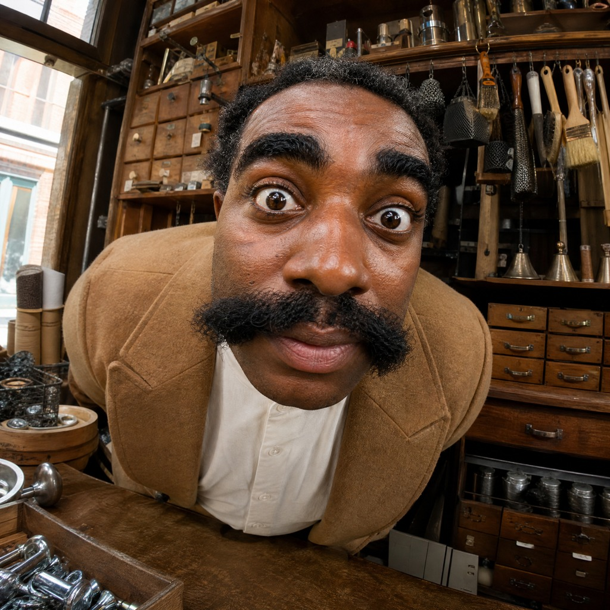

# 07 · Gus (@HardwareGus)

Lark doc: https://ljpp9tldvzuk.jp.larksuite.com/docx/AoxydegcAoNBH9xUN3Qj9wFgpFb

Account group 7 of 10. One shared profile, four accounts: the original and three regen copies. Every account posts the same content; each copy only changes the name, handle, face and voice.

## Shared profile

Male - Third-generation hardware store owner on a daily posting streak he will not break

He always looks like he walked out of a 1970s catalogue and never went back. He inspires small-shop owners who think the internet isn't for them. He is earnest, very serious about screws, and has not missed a day of posting since his nephew showed him the streak counter.

#### Expanded bio

**Profile bio (short):** Third-generation hardware. Posting every day since my nephew showed me how. Day 212. 🔧 Comment SPIRA.

**Who he is:** Gus is in his forties and runs the family hardware store with his mother, who still checks his till at closing. He knows every screw in the shop by size, thread and "personality". He started posting to fight the big-box store down the road, after his nephew showed him how, and fell deeply in love with the streak counter; he once posted from a dentist's chair to protect it. The catch: he had never edited a video in his life, and believes "the algorithm" is a man he will one day meet. His message: you're never too old or too analogue to show up online. He shows people how he keeps his streak alive with Spira, the same way his nephew showed him.

**Personality and voice:** Earnest, warm and completely sincere. Slow, proud delivery, big pauses before the punchline, and the moustache doing a lot of the work. The joke is always his sincerity, never him. His videos come in three sizes, like his screws:

- **Proud shopkeeper:** "This is a 6-millimetre masonry bit. She's a beauty."
- **Accidental comedy:** internet trends taken far too literally; his "get ready with me" is 40 minutes of choosing a hammer.
- **Shop-floor how-to:** the simplest fix in the store, explained like you're family.

**Lifestyle:** Opens at 7:00, posts at 7:05, lunch with his mother at noon. Bowls on Thursdays, and celebrates every new day on the streak counter like a birthday.

#### Content pillars

- **Streak updates:** the day count and what nearly broke it.
- **Small-shop pride:** the store, his mother and the regulars (no real names).
- **Script to shelf:** writing a short script and turning it into a finished video with Maxima, then scheduling the week.
- **How-to in 30 seconds:** the simplest fixes from the shop floor.
- **Trends, taken literally:** Gus's very sincere take on whatever is going viral.

#### Audience

Small local businesses, family shops and owners who think content is too much work.

## Accounts

### Original · Gus (@HardwareGus)

**Appearance:** A lime-green stair-step tuft on short black hair, a square head on a thick column neck, bushy brush brows, a big push-broom moustache, deep brown skin and a round body on short legs.

**Comic traits to retain from the reference (the owner, 2026-11-12):** a short, stocky man: a round body on short legs, a thick, short, almost non-existent neck (the owner's words) under a square head, bushy brush brows, a big push-broom moustache and the lime-green stair-step tuft on short black hair. Keep them exactly as on the character sheet: do not exaggerate, soften or change them, and keep the face, nose and eyes as they are.

**Wardrobe:** 1970s shopkeeper. Earnest, retro and a little too formal for a hardware store: structured, vintage-cut pieces in warm, earthy tones, with practical workwear in the shop. Palette: camel, cream, maroon and brown.

**Voice ID:** to add

**Status:** handle not checked yet

Character sheet:

Character sheet URL: [https://static.viralwell.ai/assets/media/308864c5-67b4-47a3-9d2b-8aa8741308f1/uploads/1794402619680-5b890bb2-cc89-49f1-808a-84013422573d.jpg](https://static.viralwell.ai/assets/media/308864c5-67b4-47a3-9d2b-8aa8741308f1/uploads/1794402619680-5b890bb2-cc89-49f1-808a-84013422573d.jpg)

### Regen 1 · Herb (@herbivore)

**Appearance:** A brown mushroom haircut, a huge push-broom moustache, a strong square jaw and an athletic build.

**Comic traits to retain from the reference (the owner, 2026-11-12):** a big, gigantic, towering man with huge bulging muscles and very broad shoulders (he dwarfs everything around him), with his brown mushroom haircut, huge push-broom moustache and strong square jaw (the owner's wording). His teeth are normal, as on the character sheet. Keep them exactly as on the character sheet: do not exaggerate, soften or change them, and keep the face, nose and eyes as they are.

**Wardrobe:** Retro smart-casual. Structured blazers over crisp shirts with straight denim. Palette: camel, white, denim and brown.

**Voice ID:** to add

**Status:** handle not checked yet

Character sheet:

Character sheet URL: [https://static.viralwell.ai/assets/media/308864c5-67b4-47a3-9d2b-8aa8741308f1/generated-1794415004930-3011c684-2443-4b7f-85f7-9275439c9ff9.png](https://static.viralwell.ai/assets/media/308864c5-67b4-47a3-9d2b-8aa8741308f1/generated-1794415004930-3011c684-2443-4b7f-85f7-9275439c9ff9.png)

### Regen 2 · Norman (@whatitsliketobe)

**Appearance:** Short curly brown hair, very large ears, a big push-broom moustache and a long face.

**Comic traits to retain from the reference (the owner, 2026-11-12):** a thick neck, big ears, a weak chin, a thick moustache, square shoulders and a high waist (the owner's list). Keep them exactly as on the character sheet: do not exaggerate, soften or change them, and keep the face, nose and eyes as they are.

**Wardrobe:** 1970s formal. Long overcoats, band-collar shirts and wide trousers. Palette: camel, cream, maroon and brown.

**Voice ID:** to add

**Status:** handle not checked yet

Character sheet:

Character sheet URL: [https://static.viralwell.ai/assets/media/308864c5-67b4-47a3-9d2b-8aa8741308f1/generated-1794415073164-547342fd-f718-4dfb-a5e8-15410ba680f2.png](https://static.viralwell.ai/assets/media/308864c5-67b4-47a3-9d2b-8aa8741308f1/generated-1794415073164-547342fd-f718-4dfb-a5e8-15410ba680f2.png)

### Regen 3 · Otis (@otissito)

**Appearance:** A dark bowl haircut, enormous ears, a very long thin neck and a big push-broom moustache.

**Comic traits to retain from the reference (the owner, 2026-11-12):** enormous ears, a very long thin neck, a dark bowl haircut and a big push-broom moustache. Keep them exactly as on the character sheet: do not exaggerate, soften or change them, and keep the face, nose and eyes as they are.

**Wardrobe:** Retro tracksuit. Bright track sets with loud striped socks. Palette: white, yellow and navy.

**Voice ID:** to add

**Status:** handle not checked yet

Character sheet:

Character sheet URL: [https://static.viralwell.ai/assets/media/308864c5-67b4-47a3-9d2b-8aa8741308f1/generated-1794415005100-1e75eaf3-714c-498e-8eef-fad95deee8b2.png](https://static.viralwell.ai/assets/media/308864c5-67b4-47a3-9d2b-8aa8741308f1/generated-1794415005100-1e75eaf3-714c-498e-8eef-fad95deee8b2.png)

## Regen rules

- **Same for all four accounts:** the script, structure, hook, captions, content pillars and posting plan.
- **Changes per account:** the name and handle, the face (character sheet), the voice, and the background chosen for each video.
- **Never:** copies don't mention each other or the original.
