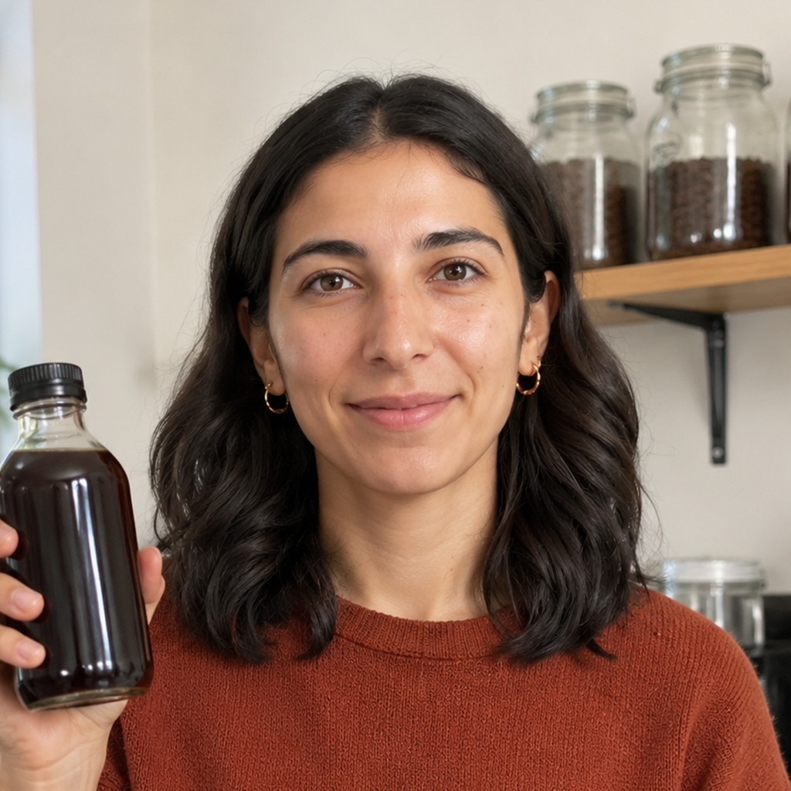
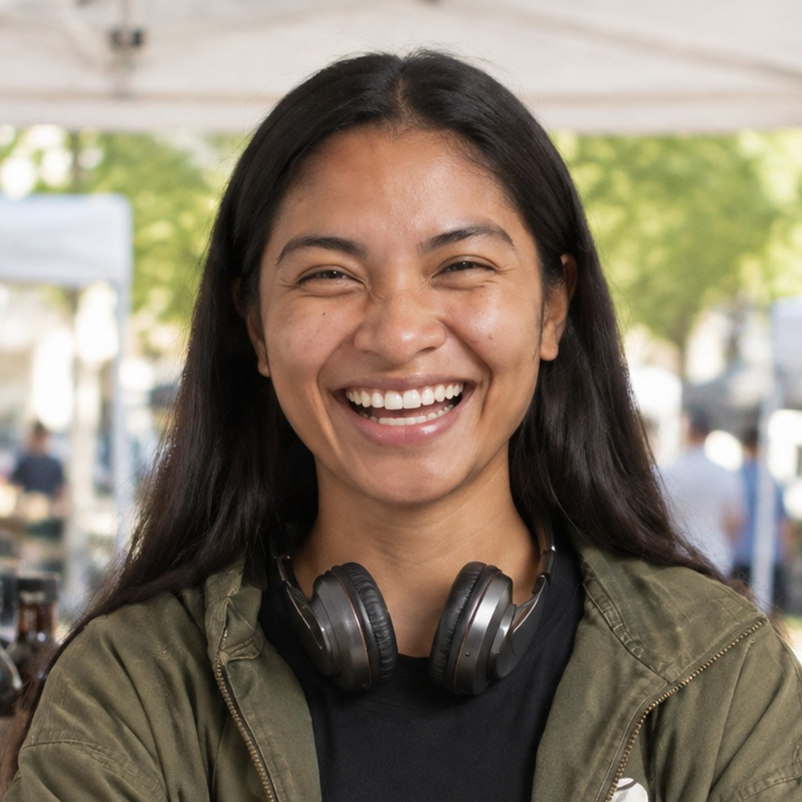
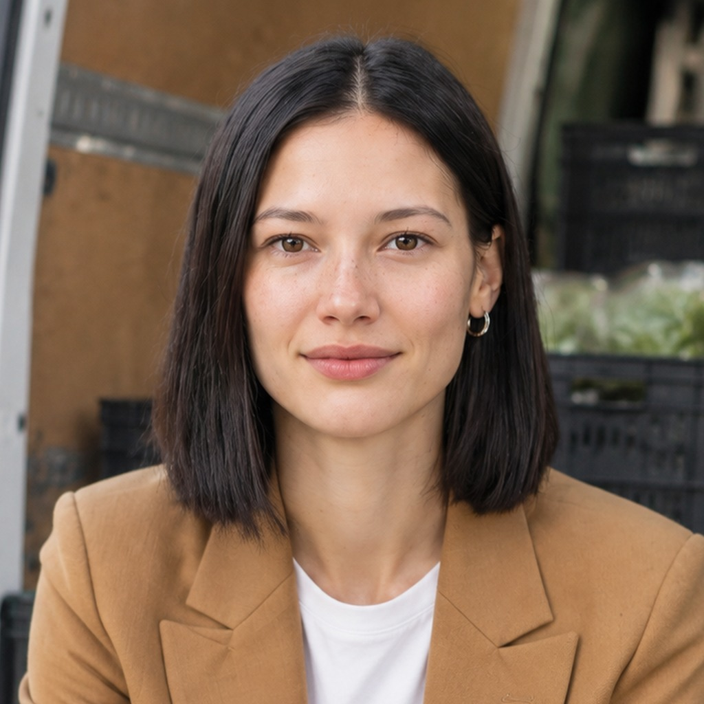
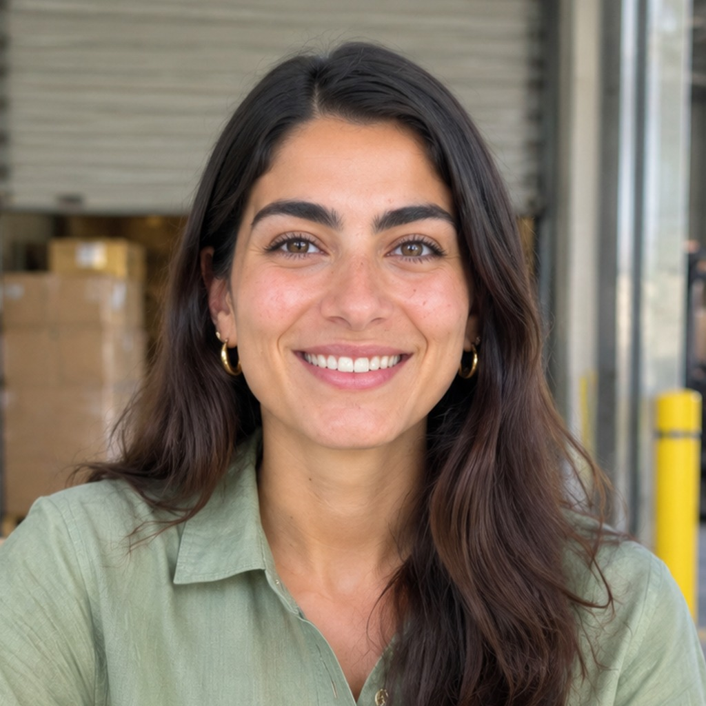

# 09 · Sofia (@sofistartsup)

Lark doc: https://ljpp9tldvzuk.jp.larksuite.com/docx/ZB4idFUtSoK4Kwxk6kAjF53Fppg

Account group 9 of 10. One shared profile, four accounts: the original and three regen copies. Every account posts the same content; each copy only changes the name, handle, face and voice.

## Shared profile

Female - Founder of a small-batch cold-brew brand, building it in public

She always looks warm, casual and a little caffeinated. She inspires first-time founders who are scared to start. She is boyish, high-energy and endlessly enthusiastic, and her girlfriend is her delivery driver and taste-tester.

#### Expanded bio

**Profile bio (short):** quit corporate to sell cold brew ☕ building in public, wins and flops. Comment SPIRA.

**Who she is:** Sofia is 31, American, and lives in San Antonio, Texas. She quit her corporate retail job at 29 to start a small-batch cold-brew brand from her kitchen. She lives with her girlfriend, who doubles as her delivery driver and taste-tester. She posts the whole journey week by week: the wins, the flat weeks, and the months she wasn't sure she could pay herself. Her message: you don't need it all figured out to start. She shows people how her whole content calendar runs on Spira, so she can stay focused on the business.

**Personality and voice:** Boyish, high-energy and endlessly enthusiastic about entrepreneurship: the friend who hypes your business idea at 1am. She's motivational without being fake, and sometimes gets honest on camera about money stress and self-doubt before talking herself back up. Her energy comes in three speeds:

- **Hype friend:** motivation for first-time founders, without being fake.
- **Honest founder:** money stress and self-doubt on camera, before she talks herself back up.
- **Kitchen-table advice:** simple, honest tips for first-time founders, from pricing to packaging.

**Lifestyle:** Early brewing, late nights on the business and lots of taste tests.

#### Content pillars

- **Founder diaries:** the week-by-week story of building the brand.
- **Motivation for first-time founders:** honest encouragement to start.
- **Honest money talks:** the flat weeks and the hard months, framed as a fictional brand's numbers.
- **Content on autopilot:** how her content calendar runs in Spira while she runs the business, ending with "Comment SPIRA".
- **Her life:** her girlfriend, San Antonio and the kitchen.

#### Audience

First-time founders, small food and drink brands and anyone thinking of quitting to start something.

## Accounts

### Original · Sofia (@sofistartsup)

**Appearance:** American, 31. Dark wavy shoulder-length hair, olive skin, dark brown eyes and small gold hoops.

**Wardrobe:** Boyish and relaxed, never feminine. Cosy, oversized, lived-in pieces and practical layers, ready for brewing and delivery runs. Palette: rust, cream, denim and gold.

**Voice ID:** to add

**Status:** handle not checked yet

Character sheet:

Character sheet URL: [https://static-dev.viralwell.ai/assets/media/ab9d20cb-c47b-442b-aa39-386887dc361c/generated-1794275088344-4d096c2d-cfc2-4dbb-8966-61950685b163.png](https://static-dev.viralwell.ai/assets/media/ab9d20cb-c47b-442b-aa39-386887dc361c/generated-1794275088344-4d096c2d-cfc2-4dbb-8966-61950685b163.png)

### Regen 1 · Sina (@sinamatic)

**Appearance:** American Samoan, 28. Long straight black hair, warm brown skin and a few small beauty marks. Headphones around her neck most of the time.

**Wardrobe:** Boyish and practical, never feminine. Utility-inspired, oversized layers built for long shoot days, with her headphones always close. Palette: olive, black, white and earth tones.

**Voice ID:** to add

**Status:** handle not checked yet

Character sheet:

Character sheet URL: [https://static-dev.viralwell.ai/assets/media/ab9d20cb-c47b-442b-aa39-386887dc361c/generated-1794275057367-ca9d30aa-d330-47be-aaea-08f0cd6cfcab.png](https://static-dev.viralwell.ai/assets/media/ab9d20cb-c47b-442b-aa39-386887dc361c/generated-1794275057367-ca9d30aa-d330-47be-aaea-08f0cd6cfcab.png)

### Regen 2 · Claire (@clairehandlesit)

**Appearance:** White American, 27. Sleek, straight black hair in a shoulder-length bob with a middle part, and small silver hoops.

**Wardrobe:** Smart casual. Friendly and put-together: a light tailored layer over easy basics, polished enough for client visits. Palette: camel, white, denim and silver.

**Voice ID:** to add

**Status:** handle not checked yet

Character sheet:

Character sheet URL: [https://static-dev.viralwell.ai/assets/media/ab9d20cb-c47b-442b-aa39-386887dc361c/generated-1794365870377-037df768-f505-4b63-8db2-93412ccf5491.png](https://static-dev.viralwell.ai/assets/media/ab9d20cb-c47b-442b-aa39-386887dc361c/generated-1794365870377-037df768-f505-4b63-8db2-93412ccf5491.png)

### Regen 3 · Rania (@raniaway)

**Appearance:** Middle Eastern-American, late twenties. Long, straight dark brown hair with a middle part, worn down. Thick dark brows, warm brown eyes, a wide bright smile, a natural bare-faced look and small hoop earrings.

**Wardrobe:** Relaxed, boyish and menswear-inspired: loose, breezy linen and cotton layers with wide, straight cuts. Never feminine. Palette: sage, charcoal, white and stone.

**Voice ID:** to add

**Status:** handle not checked yet

Character sheet:

Character sheet URL: [https://static.viralwell.ai/assets/media/308864c5-67b4-47a3-9d2b-8aa8741308f1/generated-1794440786289-1a7d3a75-161d-4270-8ca7-93c958e09bcb.png](https://static.viralwell.ai/assets/media/308864c5-67b4-47a3-9d2b-8aa8741308f1/generated-1794440786289-1a7d3a75-161d-4270-8ca7-93c958e09bcb.png)

## Regen rules

- **Same for all four accounts:** the script, structure, hook, captions, content pillars and posting plan.
- **Changes per account:** the name and handle, the face (character sheet), the voice, and the background chosen for each video.
- **Never:** copies don't mention each other or the original.
