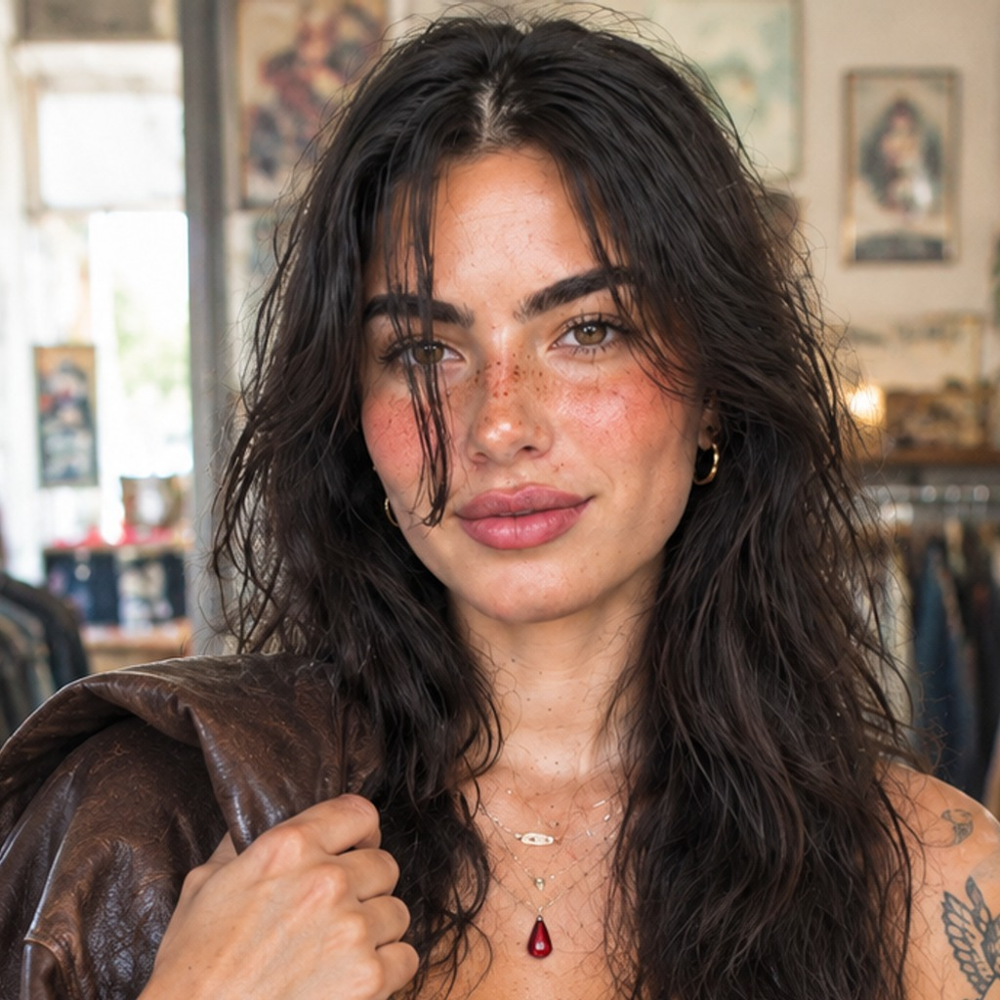
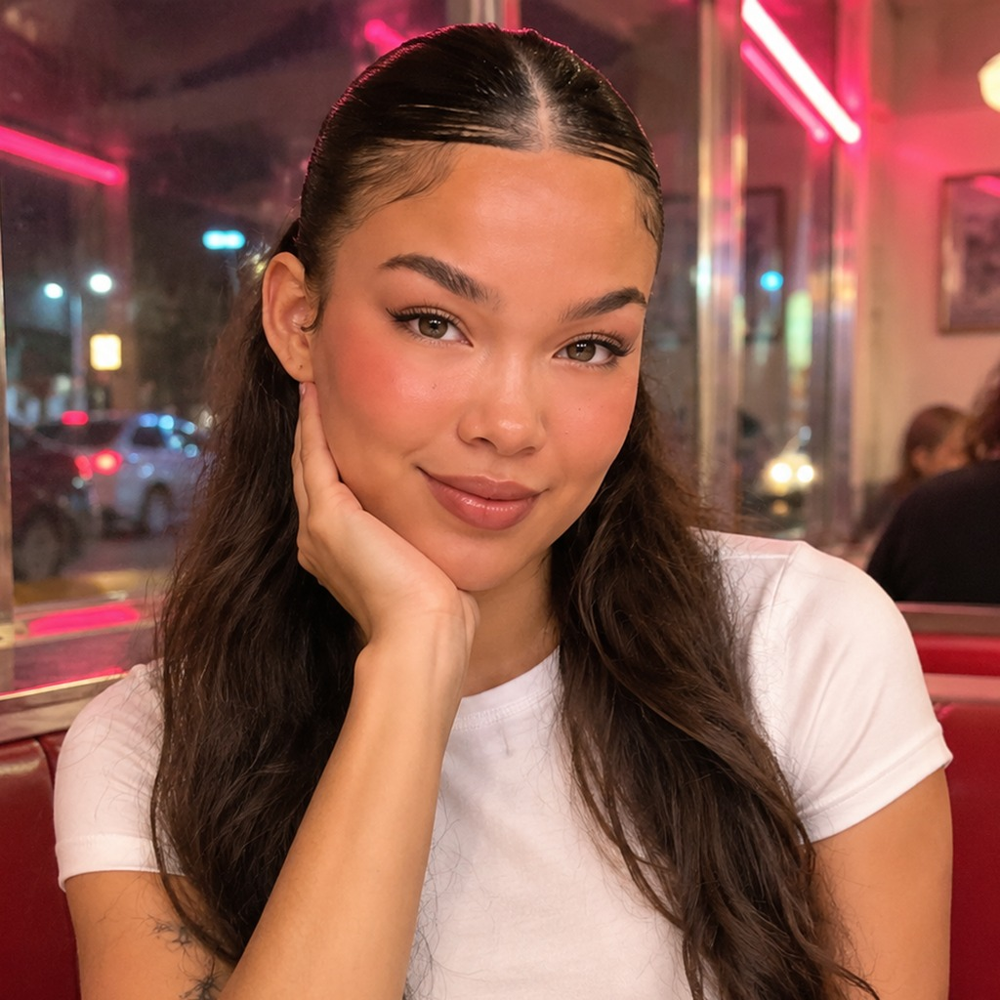
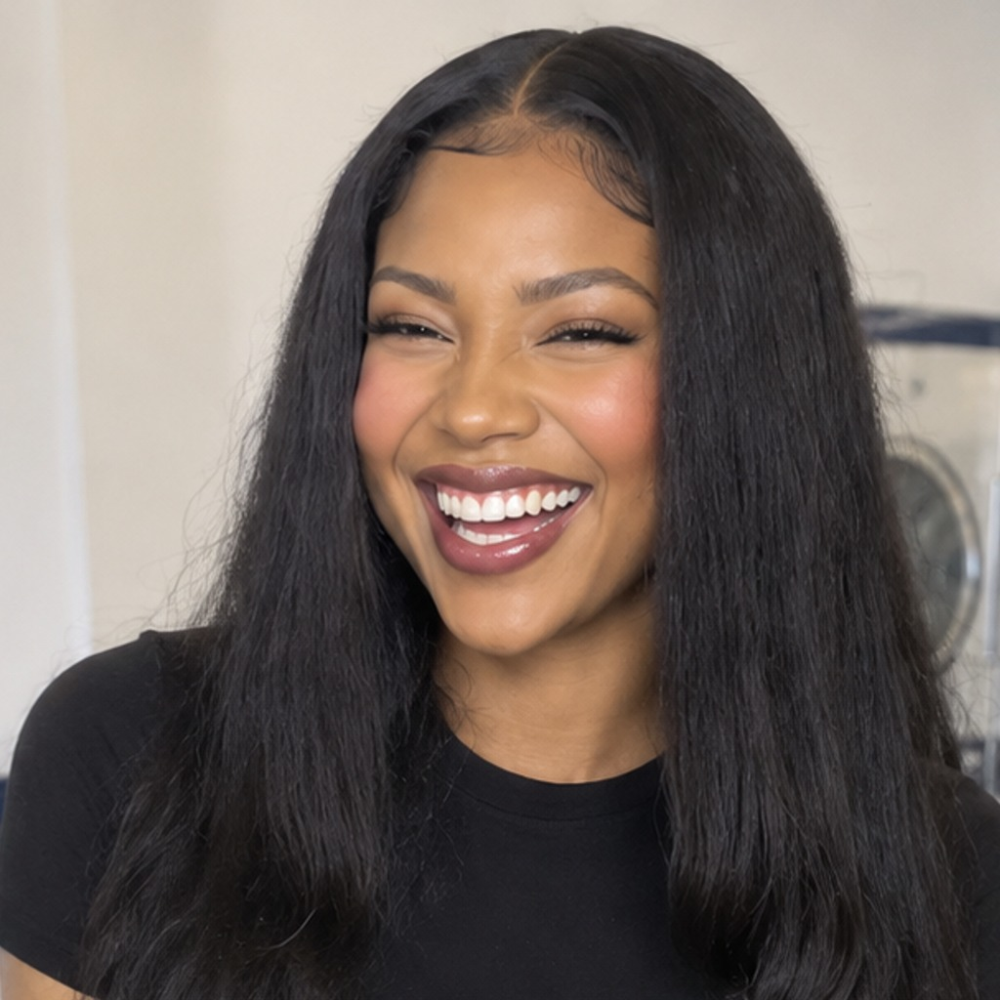

# 10 · Roxy (@itsroxy)

Lark doc: https://ljpp9tldvzuk.jp.larksuite.com/docx/RaVrdvABRotu4uxpPVRj2kjppYd

Account group 10 of 10. One shared profile, four accounts: the original and three regen copies. Every account posts the same content; each copy only changes the name, handle, face and voice.

## Shared profile

Female - Model and "it girl" turned CMO of a creator startup

She is bold, unbothered and funny, with a vintage-meets-Y2K style everyone screenshots. She went from being the face of other brands' campaigns to running marketing for a startup. She says what everyone's thinking, laughs at herself first, and refuses to be boring.

#### Expanded bio

**Profile bio (short):** model turned CMO 💋 professional life-dumper. anti-bland. making my content with Spira (no editing). ✨ Comment SPIRA.

**Who she is:** Roxy is in her mid-twenties and lives in LA. She started modelling at 19, shooting campaigns and magazine covers, and built a big following by being herself: loud style, honest captions and zero filter. Last year she became CMO of a creator startup, and now she runs launches, campaigns and a content calendar that never stops. Her message: be bold, be yourself, and don't let "I don't have time to edit" be the reason you stop posting. She shows people how she keeps her feed and her company's content going with Spira, fast, funny and with zero jargon.

**Personality and voice:** Confident, playful and a little chaotic. Dry one-liners, self-roasting captions ("be nice, I'm fragile"), and big laughs on camera. She talks to camera like she's getting ready with her best friend before a night out. She has three modes:

- **Unfiltered:** bold opinions on style, beauty and being yourself ("being boring is the only real fashion crime").
- **CMO mode:** behind the scenes of running marketing at a startup: launches, campaign shoots, the meeting where everyone wants it "more viral".
- **The CMO breakdown:** quick, no-jargon demos of how she makes her content with Spira.

**Lifestyle:** Late mornings, iced coffee, vintage shopping on weekends. I love martinis, road trips and dinner with friends that turn into a night out. Work hard on launches, then disappears into a photo dump.

#### Content pillars

- **Life dumps:** photo-dump carousels of her week with funny captions and a surprise last slide.
- **Style and self-expression:** outfit inspo, vintage finds, bold makeup and "anti-bland" style tips.
- **CMO diaries:** behind the scenes of startup marketing: launches, campaigns, shoots and creator partnerships.
- **Content, CMO-style:** on-screen demos of how she keeps two feeds going with Spira, ending with "Comment SPIRA".
- **Her life:** LA nights, road trips, shoots and friends.

#### Audience

Women aged 18 to 30 who love fashion, bold style and unfiltered humour, plus creators, models and marketers who post a lot and want to spend less time editing. Core market: the US.

Account inspiration:

@arikytsya

## Accounts

### Original · Roxy (@itsroxy)

**Appearance:** Italian-American, mid-twenties, curvy. Long, tousled black waves with curtain bangs, usually worn down. Green-hazel eyes, freckles across her nose and cheeks, flushed cheeks, full brows and a glossy lip. Fine-line tattoos on her arms and shoulders, a gold necklace with a red drop pendant, and small gold hoops.

**Features to retain from the reference (the owner, 2026-11-12):** maintain the figure of the person from the character sheet image. Keep it as on the image and keep the face as it is. Never describe the body with explicit wording in a prompt.

**Wardrobe:** Vintage meets Y2K, always a bit loud but never explicit. Bold prints, playful textures and statement accessories, with sharp tailoring on CMO days and fun, eye-catching mixes everywhere else. Palette: red, leopard, black, cream, silver and pearl.

**Voice ID:** to add

**Status:** handle not checked yet

Character sheet:

Character sheet URL: [https://static.viralwell.ai/assets/media/86641e68-954b-412d-b3b5-e3710b105cbf/generated-1794226719173-ecd2a15d-ba22-4793-b3e9-3c482a37d271.png](https://static.viralwell.ai/assets/media/86641e68-954b-412d-b3b5-e3710b105cbf/generated-1794226719173-ecd2a15d-ba22-4793-b3e9-3c482a37d271.png)

### Regen 1 · Gina (@ginaandtonic)

**Appearance:** Italian-American, mid-twenties, with a slim-thick hourglass figure and a small waist. Long dark brown wavy hair with a middle part, often slicked back into a half-up style. Brown eyes, defined brows, rosy flushed cheeks and a soft closed-mouth smile. Simple, cute small tattoos on her arms.

**Features to retain from the reference (the owner, 2026-11-12):** maintain the figure of the person from the character sheet image. Keep it as on the image and keep the face as it is. Never describe the body with explicit wording in a prompt.

**Wardrobe:** Clean, sporty casual that shows her shape: fitted, cropped basics with high-waisted denim. Simple and effortless. Palette: white, light denim, grey and black.

**Voice ID:** to add

**Status:** handle not checked yet

Character sheet:

Character sheet URL: [https://static.viralwell.ai/assets/media/308864c5-67b4-47a3-9d2b-8aa8741308f1/generated-1794440656885-1603b460-e517-4745-aff6-72e67484840e.png](https://static.viralwell.ai/assets/media/308864c5-67b4-47a3-9d2b-8aa8741308f1/generated-1794440656885-1603b460-e517-4745-aff6-72e67484840e.png)

### Regen 2 · Celia (@itscelia)

**Appearance:** Cuban-American, mid-twenties, with a curvy hourglass figure, a full bust and a small waist. Long dark brown hair with a middle part, worn down. Thick dark brows, brown eyes, full lips and a confident closed-mouth smile. Simple, cute small tattoos on her arms.

**Features to retain from the reference (the owner, 2026-11-12):** maintain the figure of the person from the character sheet image. Keep it as on the image and keep the face as it is. Never describe the body with explicit wording in a prompt.

**Wardrobe:** Sleek and body-hugging on top, relaxed and utilitarian below. Polished but easy, never fussy. Palette: black, beige, khaki and white.

**Voice ID:** to add

**Status:** handle not checked yet

Character sheet:

Character sheet URL: [https://static.viralwell.ai/assets/media/308864c5-67b4-47a3-9d2b-8aa8741308f1/generated-1794440515393-e84318d9-0e8a-4bee-844e-5257f1d4b529.png](https://static.viralwell.ai/assets/media/308864c5-67b4-47a3-9d2b-8aa8741308f1/generated-1794440515393-e84318d9-0e8a-4bee-844e-5257f1d4b529.png)

### Regen 3 · Dionne (@dionnewithit)

**Appearance:** African-American, mid-twenties, with a curvy hourglass figure and a small waist. Long, sleek, straight black hair with a middle part. Lifted brown eyes, defined lashes, rosy cheeks and a berry-toned lip. Simple, cute small tattoos on her arms.

**Features to retain from the reference (the owner, 2026-11-12):** maintain the figure of the person from the character sheet image. Keep it as on the image and keep the face as it is. Never describe the body with explicit wording in a prompt.

**Wardrobe:** Laid-back streetwear: fitted, cropped basics with relaxed high-waisted denim. Easy and confident. Palette: black, mid-wash denim, white and grey.

**Voice ID:** to add

**Status:** handle not checked yet

Character sheet:

Character sheet URL: [https://static.viralwell.ai/assets/media/308864c5-67b4-47a3-9d2b-8aa8741308f1/generated-1794440511150-dcd3b4bc-1d26-4251-89e3-dcc85f171a0d.png](https://static.viralwell.ai/assets/media/308864c5-67b4-47a3-9d2b-8aa8741308f1/generated-1794440511150-dcd3b4bc-1d26-4251-89e3-dcc85f171a0d.png)

## Regen rules

- **Same for all four accounts:** the script, structure, hook, captions, content pillars and posting plan.
- **Changes per account:** the name and handle, the face (character sheet), the voice, and the background chosen for each video.
- **Never:** copies don't mention each other or the original.
